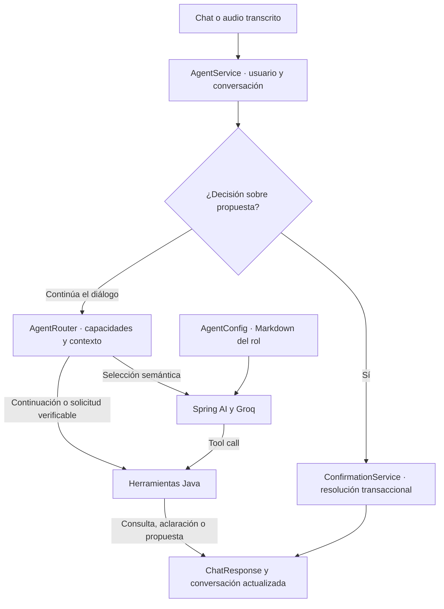

# Arquitectura del agente UniRide

```text
agent/
├── AgentConfig.java
├── AgentRouter.java
├── AgentService.java
├── tools/
│   ├── conductor/     RutaTools, ViajeConductorTools, SolicitudesConductorTools
│   ├── pasajero/      ViajePasajeroTools, ContribucionTools
│   └── shared/        CompensacionTools, PerfilTools, HorarioTools, ReportesTools
├── conversation/     sesión, borrador tipado, aclaraciones y referencias
├── confirmation/     propuestas persistidas y ejecución transaccional
├── dto/              contrato HTTP y resultados de herramientas
├── support/          consultas, diagnósticos y resúmenes basados en resultados
├── voice/            transcripción y texto hablado
└── controller/       endpoints de chat, voz y confirmaciones
```

| Clase | Responsabilidad |
| --- | --- |
| `AgentConfig` | Construye el `ChatClient` y lee `classpath:agent/system-prompt.md` como UTF-8 al arrancar. Valida el recurso y las secciones por rol. El JAR incluye el Markdown en `BOOT-INF/classes/agent/`. |
| `AgentRouter` | Registra cada callback con su ámbito, modo de acceso y tipo de contexto. Aplica autorización por rol, limita las ejecuciones, construye el `ToolContext` y conserva los recibos. |
| `AgentService` | Obtiene el usuario autenticado, abre la conversación, resuelve decisiones y continuaciones, ejecuta el turno local o semántico y guarda el resultado y el borrador vigentes. |



## Herramientas por rol

| Ámbito | Lecturas | Preparaciones | Total |
| --- | ---: | ---: | ---: |
| Conductor | 6 | 12 | 18 |
| Pasajero | 3 | 2 | 5 |
| Compartidas | 7 | 9 | 16 |
| Total | 16 | 23 | 39 |

Una consulta de PDF entrega la referencia a una descarga de solo lectura. Las
23 preparaciones de negocio generan propuestas que requieren una decisión explícita.
Al arrancar, el router contrasta el catálogo con los métodos `@Tool` y detecta
nombres duplicados.

| Clase | Herramientas |
| --- | --- |
| `RutaTools` | `consultarMisRutas`, `crearRuta`, `editarRuta`, `eliminarRuta`, `consultarRankingMisRutas` |
| `ViajeConductorTools` | `consultarMisViajes`, `crearViaje`, `reprogramarViaje`, `confirmarViaje`, `iniciarViaje`, `completarViaje`, `cancelarViaje`, `consultarEstadoNotificaciones` |
| `SolicitudesConductorTools` | `consultarSolicitudesRecibidas`, `consultarDetalleSolicitudRecibida`, `aceptarSolicitud`, `rechazarSolicitud`, `rechazarSolicitudesPendientes` |
| `ViajePasajeroTools` | `buscarViajes`, `consultarMisSolicitudes`, `solicitarUnirse`, `cancelarSolicitud` |
| `ContribucionTools` | `sugerirContribucionViaje` |
| `CompensacionTools` | `consultarMisMetodosCompensacion`, `registrarMetodoCompensacion`, `actualizarMetodoCompensacion`, `cambiarEstadoMetodoCompensacion`, `eliminarMetodoCompensacion` |
| `PerfilTools` | `consultarMiPerfil`, `consultarMiUsuario`, `editarPerfil`, `editarInfoAdicional`, `cambiarRol` |
| `HorarioTools` | `consultarMisHorarios`, `registrarCurso`, `eliminarCurso` |
| `ReportesTools` | `consultarMisEstadisticas`, `consultarMiFrecuenciaViajes`, `prepararDescargaHistorialPdf` |

## Cómo transcurre un turno

- **Consulta.** Una petición inequívoca, como listar métodos propios, se ejecuta directamente. Para «¿Quién está en lista de espera para mi salida de mañana?», Groq puede seleccionar `consultarSolicitudesRecibidas` y Java resuelve la fecha de Lima, los filtros y la propiedad. Las herramientas contextuales ignoran los IDs y filtros del JSON del modelo.
- **Escritura.** Java comprueba que la petición y los datos permitan preparar la operación. La herramienta obtiene la propuesta de `ConfirmationService`. El usuario la puede confirmar o cancelar por chat o mediante el endpoint por UUID. La resolución revisa propiedad, estado, expiración y cambios de negocio en una transacción.
- **Aclaración.** Java construye el descriptor v1 con UUID, campos y opciones autorizadas. El `conversationId` y el UUID vinculan el envío de Angular al formulario activo. El borrador tipado conserva los datos para continuar por campo, texto o voz.
- **Voz.** `/api/agent/voz` transcribe una vez con Whisper y usa el flujo de chat. Java construye `spokenText` a partir del mismo resultado.
- **Error.** Un 429, un timeout o una respuesta inválida usan los códigos existentes. Si ya hay recibos, la respuesta conserva los resultados con una advertencia. Si la persistencia de una propuesta es incierta, `PREPARATION_RESULT_UNCERTAIN` indica revisar las confirmaciones antes de enviar otro pedido.

El router prioriza el formulario vigente. Las reglas locales conservan el camino
directo para acciones inequívocas y protegen las preparaciones ante preguntas,
negaciones y datos sin respaldo. Si Groq identifica una operación que requiere
datos, el router conserva la aclaración de Java o admite una pregunta breve y
segura. El turno admite ocho invocaciones y una preparación.

## Verificación

```powershell
.\mvnw.cmd clean verify
.\scripts\test-agent-postgres.ps1
git diff --check
jar tf target\uniride-0.0.1-SNAPSHOT.jar | Select-String 'BOOT-INF/classes/agent/system-prompt.md'
docker build -t uniride-agent-router:local .
```

En el commit base `19a0f56` pasaron 1.060 pruebas de Maven y 111 de PostgreSQL.
En esta refactorización pasaron 1.071 y 111, respectivamente. Ambas ejecuciones
finales terminaron con cero fallos, errores y omisiones. La imagen arrancó con
PostgreSQL 18.6 en una red aislada y el Markdown coincidió con el recurso en
ambos JAR, el de Maven y el de Docker.

El bloque anterior tenía 2.590 caracteres y 2.628 bytes UTF-8. El archivo
Markdown tiene 3.933 caracteres y 4.019 bytes. Por petición, la sección del
conductor con las reglas comunes ocupa 3.565 caracteres y 3.648 bytes. Para el
pasajero ocupa 3.408 caracteres y 3.489 bytes. Estos tamaños excluyen el historial,
el mensaje y los esquemas de herramientas.

Estos conteos de llamadas HTTP de chat se comprueban con el transporte real
de Spring AI y un servidor Groq simulado.

| Recorrido probado | Llamadas |
| --- | ---: |
| Listado inequívoco de métodos, contribución local, formulario o decisión de confirmación | 0 |
| Petición semántica de coordinación o de contribución con resultado directo | 1 |
| Petición semántica incompleta de registro de un método | 1 |
| Petición semántica de PDF con respuesta posterior al callback | 2 |

## Sesión controlada con Groq y Whisper

Arranca el backend con `GROQ_API_KEY` del entorno y una base local aislada con
cuentas, rutas, viajes y solicitudes de prueba. Usa un JWT de cada rol. El nivel
`DEBUG` para `com.uniride.agent.support.GroqHttpDiagnostics` registra los estados
y las rondas HTTP del chat. Los resultados estructurados identifican el callback
seleccionado. Una traza de las herramientas ofrecidas solo necesita los nombres
de `AgentRouter.Turn.callbacks`.

```powershell
$headers = @{ Authorization = "Bearer $env:UNIRIDE_TEST_JWT" }
$body = @{ message = '¿Quién está en lista de espera para mi salida de mañana?' } | ConvertTo-Json
Invoke-RestMethod -Method Post -Uri 'http://localhost:8080/api/agent/chat' -Headers $headers -ContentType 'application/json; charset=utf-8' -Body $body
curl.exe -sS -H "Authorization: Bearer $env:UNIRIDE_TEST_JWT" -F 'audio=@consulta-prueba.webm;type=audio/webm' http://localhost:8080/api/agent/voz
```

| Rol de prueba | Mensaje | Capacidad esperada |
| --- | --- | --- |
| Conductor | ¿Quién está en lista de espera para mi salida de mañana? | `consultarSolicitudesRecibidas` |
| Conductor | ¿Me ayudas a registrar una nueva ruta? | `crearRuta`, con aclaración de datos |
| Pasajero | ¿Qué viajes salen mañana por la mañana? | `buscarViajes` |
| Pasajero | ¿Con cuánto colaboro para un viaje de Surco a la UPC con 3 pasajeros? | `sugerirContribucionViaje` |
| Cualquiera | Necesito una copia en PDF de mis viajes del mes pasado | `prepararDescargaHistorialPdf` |
| Cualquiera | Quisiera añadir una forma de compensación para pagar con Yape | `registrarMetodoCompensacion`, con aclaración |

Registra mensaje, rol, callbacks ofrecidos y seleccionados, resultado, rondas de
chat, aclaración, propuesta, respuesta genérica y error. Usa audio sintético o
grabado para la prueba y evita guardar credenciales o datos personales.
Comprueba una propuesta sin confirmarla si solo estás comprobando el recorrido.

[Contrato HTTP](agente_flujo.md) · [Aclaraciones v1](agente_aclaraciones.md) · [Voz](agente_voz.md) · [Integración Spring AI](instrucciones_agente_spring_ai.md)
