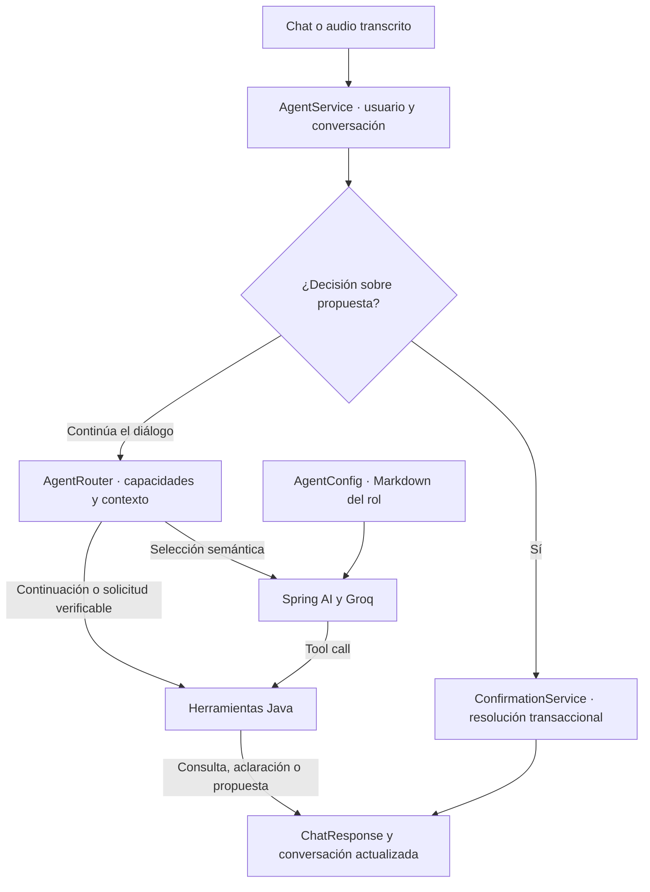

# Arquitectura del agente UniRide

```text
agent/
├── AgentConfig.java
├── AgentRouter.java
├── AgentService.java
├── tools/
│   ├── conductor/     RutaTools, ViajeConductorTools, SolicitudesConductorTools
│   ├── pasajero/      ViajePasajeroTools, ContribucionTools
│   └── shared/        CompensacionTools, PerfilTools, HorarioTools, ReportesTools
├── conversation/     sesión, borrador tipado, aclaraciones y referencias
├── confirmation/     propuestas persistidas y ejecución transaccional
├── dto/              contrato HTTP y resultados de herramientas
├── support/          consultas, diagnósticos y resúmenes basados en resultados
├── voice/            transcripción y texto hablado
└── controller/       endpoints de chat, voz y confirmaciones
```

| Clase | Responsabilidad |
| --- | --- |
| `AgentConfig` | Construye el `ChatClient` y lee `classpath:agent/system-prompt.md` como UTF-8 al arrancar. Valida el recurso y las secciones por rol. El JAR incluye el Markdown en `BOOT-INF/classes/agent/`. |
| `AgentRouter` | Registra cada callback con su ámbito, modo de acceso y tipo de contexto. Aplica autorización por rol, limita las ejecuciones, construye el `ToolContext` y conserva los recibos. |
| `AgentService` | Obtiene el usuario autenticado, abre la conversación, resuelve decisiones y continuaciones, ejecuta el turno local o semántico y guarda el resultado y el borrador vigentes. |



## Herramientas por rol

| Ámbito | Lecturas | Preparaciones | Total |
| --- | ---: | ---: | ---: |
| Conductor | 6 | 12 | 18 |
| Pasajero | 3 | 2 | 5 |
| Compartidas | 7 | 9 | 16 |
| Total | 16 | 23 | 39 |

Una consulta de PDF entrega la referencia a una descarga de solo lectura. Las
23 preparaciones de negocio generan propuestas que requieren una decisión explícita.
Al arrancar, el router contrasta el catálogo con los métodos `@Tool` y detecta
nombres duplicados.

### Matriz de lecturas

Las rutas de la tabla se expresan bajo `/api`. Las 39 capacidades se
comprueban con el catálogo de `AgentRouterTest`. Las suites de chat usan
Spring AI con un proveedor simulado o ejecutan un recorrido local. Las pruebas de
callback, servicio y persistencia verifican además el resultado y los permisos.

| Herramienta | Rol | Lectura equivalente y reglas | Cobertura representativa |
| --- | --- | --- | --- |
| `consultarMisRutas` | Conductor | `GET /rutas`. Propias, activas y vencidas, con paginación. | Groq simulado, consultas JPA |
| `consultarRankingMisRutas` | Conductor | `GET /estadisticas/rutas`. Historial propio y mínimo de viajes. | Groq simulado, denegación por rol |
| `consultarMisViajes` | Conductor | `GET /rutas/{id}/viajes`. El agente agrupa viajes de rutas propias y filtra estado. | Groq simulado, callback y JPA |
| `consultarEstadoNotificaciones` | Conductor | `NotificacionService.estadoAvisosCancelacion`. Viaje propio y avisos vinculados. | Chat local y PostgreSQL |
| `consultarSolicitudesRecibidas` | Conductor | `GET /solicitudes/recibidas/por-ruta`. Viajes propios, estado y filtros. | Chat local, Groq simulado |
| `consultarDetalleSolicitudRecibida` | Conductor | `GET /solicitudes/recibidas/{id}/detalle`. Solo perfil compartido y solicitud recibida. | Chat local y autorización |
| `buscarViajes` | Pasajero | `GET /viajes/buscar`. Salidas futuras programadas. El agente añade fecha y franja US30. | Groq simulado, JPA y referencias |
| `consultarMisSolicitudes` | Pasajero | `GET /solicitudes`. Identidad propia, estado y paginación. | Groq simulado, callback y consulta de servicio |
| `sugerirContribucionViaje` | Pasajero | `GET /viajes/{id}/sugerencia-contribucion`. Identificación autorizada y reglas US29. | Chat local y Groq simulado |
| `consultarMisMetodosCompensacion` | Ambos | `GET /metodos-compensacion`. Métodos propios, con paginación en el agente. | Chat local y Groq simulado |
| `consultarMiPerfil` | Ambos | `GET /perfil`. Perfil propio y situación de perfil inicial. | Groq simulado, callback y servicio |
| `consultarMiUsuario` | Ambos | `GET /usuarios/me`. Cuenta autenticada. | Groq simulado, callback y servicio |
| `consultarMisHorarios` | Ambos | `GET /perfil/cursos`. Cursos propios, con filtro de día en el agente. | Groq simulado, callback y servicio |
| `consultarMisEstadisticas` | Ambos | `GET /estadisticas`. Historial propio completo. | Groq simulado y recuperación |
| `consultarMiFrecuenciaViajes` | Ambos | `GET /estadisticas/semana`. Historial propio y mínimo de viajes. | Groq simulado y recuperación |
| `prepararDescargaHistorialPdf` | Ambos | `GET /historial/pdf`. Genera la referencia autenticada con período y rol. | Groq simulado y formulario HTTP |

### Matriz de preparaciones y ejecución

La preparación valida el DTO y el rol del catálogo. La confirmación coteja
propietario, estado y vigencia del recibo, revalida el recurso cuando corresponde
y llama al servicio general. No hay escritura de negocio durante la preparación.
Las suites `ConfirmationServiceIntegrationTest` y su variante PostgreSQL cubren
el ciclo de las propuestas. `CoordinacionConductorIntegrationTest` cubre
coordinación desde el chat. Los casos de rutas, cupos, métodos, perfil y cursos
se complementan con `GroqProviderIntegrationTest` y `AgentHttpSecurityTest`.

| Herramienta y rol | REST equivalente y entrada | Preparación y validaciones | Ejecución definitiva |
| --- | --- | --- | --- |
| `crearRuta` · Conductor | `POST /rutas`, `RutaRequest` | `RutaService.validarPublicacion`. Datos completos, capacidad positiva, conductor habilitado y destino del perfil. | `RutaService.publicar` |
| `editarRuta` · Conductor | `PUT /rutas/{id}`, `RutaRequest` | Ruta propia. `RutaService.validarEdicion` comprueba estado, viajes en progreso y capacidad respecto a aceptadas. | `RutaService.actualizar`, con bloqueo y confirmación de impacto |
| `eliminarRuta` · Conductor | `DELETE /rutas/{id}` | Ruta propia. `RutaService.validarEliminacion` impide interrumpir viajes en progreso. | `RutaService.eliminar`, con confirmación de impacto y conservación del historial |
| `crearViaje` · Conductor | `POST /rutas/{rutaId}/viajes`, `ViajeRequest` | `ViajeService.validarCreacion`. Ruta propia vigente, fecha y hora futuras y anticipación. | `ViajeService.crear` |
| `reprogramarViaje` · Conductor | `PUT /viajes/{id}`, `ViajeRequest` | Viaje propio. `ViajeService.validarReprogramacion` comprueba ruta, `PROGRAMADO`, diferencia y anticipación. | `ViajeService.actualizar`, con bloqueo, aviso y nueva confirmación de salida |
| `confirmarViaje` · Conductor | `PUT /viajes/{id}/confirmar` | Viaje propio. `ViajeService.validarConfirmacion` comprueba estado y plazo. | `ViajeService.confirmar` y efectos de US17 |
| `iniciarViaje` · Conductor | `PUT /viajes/{id}/iniciar` | Viaje propio. `ViajeService.validarInicio` comprueba confirmación y hora. | `ViajeService.iniciar` |
| `completarViaje` · Conductor | `PUT /viajes/{id}/completar` | Viaje propio en progreso. `ViajeService.validarFinalizacion`. | `ViajeService.completar` |
| `cancelarViaje` · Conductor | `PUT /viajes/{id}/cancelar` | Viaje propio. `ViajeService.evaluarCancelacion` calcula estado, afectación y penalidad. | `ViajeService.cancelar` tras cotejar la afectación |
| `aceptarSolicitud` · Conductor | `PUT /solicitudes/{id}/aceptar` | Solicitud recibida. `SolicitudService.validarAceptacion` comprueba estado, plazo y capacidad. | `SolicitudService.aceptar` bajo bloqueo |
| `rechazarSolicitud` · Conductor | `PUT /solicitudes/{id}/rechazar`, `RechazarSolicitudRequest` | Solicitud recibida procesable y motivo opcional validado. | `SolicitudService.rechazar` |
| `rechazarSolicitudesPendientes` · Conductor | `PUT /solicitudes/rechazar-multiples`, `RechazarMultipleRequest` | Selección de pendientes recibidas del mismo viaje y motivo validado. | `SolicitudService.rechazarMultiple` después de comprobar las pendientes vigentes |
| `solicitarUnirse` · Pasajero | `POST /solicitudes/viajes/{viajeId}`, `SolicitudRequest` | `SolicitudService.validarCreacion`. Viaje ajeno, futuro y programado, sitio disponible, método autorizado y ausencia de duplicado. Revalida la salida consultada. | `SolicitudService.crear` bajo bloqueo |
| `cancelarSolicitud` · Pasajero | `PUT /solicitudes/{id}/cancelar` | `SolicitudService.validarCancelacion`. Solicitud propia pendiente, en viaje programado y futuro. | `SolicitudService.cancelar` por cada solicitud autorizada |
| `registrarMetodoCompensacion` · Ambos | `POST /metodos-compensacion`, `MetodoCompensacionRequest` | `MetodoCompensacionService.validarRegistro`. Tipo, descripción y duplicidad propia. | `MetodoCompensacionService.registrar` |
| `actualizarMetodoCompensacion` · Ambos | `PUT /metodos-compensacion/{id}`, `MetodoCompensacionRequest` | Método propio y unívoco. `MetodoCompensacionService.validarActualizacion`. | `MetodoCompensacionService.actualizar` |
| `cambiarEstadoMetodoCompensacion` · Ambos | `PUT /metodos-compensacion/{id}`, `MetodoCompensacionRequest` | Mismo validador de actualización. Conserva tipo y descripción. | `MetodoCompensacionService.actualizar` |
| `eliminarMetodoCompensacion` · Ambos | `DELETE /metodos-compensacion/{id}` | Método propio, sin solicitudes vinculadas. `MetodoCompensacionService.validarEliminacion`. | `MetodoCompensacionService.eliminar` |
| `editarPerfil` · Ambos | `PUT /perfil`, `PerfilRequest` | Perfil autenticado o inicial. `PerfilService.validarDatosPersonales` comprueba fechas y favorito requerido para conductor. | `PerfilService.guardarDatosPersonales` |
| `editarInfoAdicional` · Ambos | `PUT /perfil/info-adicional`, `InfoAdicionalRequest` | Perfil propio existente. `PerfilService.validarInfoAdicional` conserva omisiones y exige gustos, hobbies y datos curiosos resultantes. | `PerfilService.guardarInfoAdicional` |
| `cambiarRol` · Ambos | `PUT /usuarios/rol`, `CambiarRolRequest` | Rol permitido y distinto del actual. Recibo queda vinculado a la cuenta. | `UsuarioService.cambiarRol` y nueva sesión de agente |
| `registrarCurso` · Ambos | `POST /perfil/cursos`, lista de `CursoRequest` | `HorarioAcademicoService.validarRegistro`. Día, franja, orden de horas y solapamientos propios. | `HorarioAcademicoService.guardarCursos` revalida antes de persistir |
| `eliminarCurso` · Ambos | `DELETE /perfil/cursos/{id}` | Curso propio. Si coincide más de uno, Java emite un selector con opciones vigentes. | `HorarioAcademicoService.eliminarCurso` tras verificar el recibo y el curso |

**Reglas horarias verificadas.** US07, US17 y los contratos de creación y
reprogramación documentan salida futura y 12 horas de anticipación en Lima. La
auditoría de historias, Git y formularios de viaje no encontró límites para las
horas del día. Definir si una salida a las 02:08 está permitida sigue siendo una
decisión de producto. El filtro de búsqueda «madrugada» de US30 describe una
consulta. [Contratos de viajes](endpoints.md)

**Horario académico.** La guía de integración de US23/US24 del frontend define
06:00–23:00, ambos extremos incluidos. El mismo validador de
`HorarioAcademicoService` se usa al preparar, guardar manualmente e importar.
La importación conserva los cursos válidos e informa las omisiones de franja en
el mensaje existente. [Regla de horario académico en el frontend](https://github.com/Ian-1232/uniride-frontend/blob/70eda81004fc588dda9d6170c46d8a66db48d355/docs/integracion-horarios-US23-US24.md)

## Cómo transcurre un turno

- **Consulta.** Una petición inequívoca, como listar métodos propios, se ejecuta directamente. Para «¿Quién está en lista de espera para mi salida de mañana?», Groq puede seleccionar `consultarSolicitudesRecibidas` y Java resuelve la fecha de Lima, los filtros y la propiedad. Las herramientas contextuales ignoran los IDs y filtros del JSON del modelo.
- **Escritura.** Java comprueba que la petición y los datos permitan preparar la operación. La herramienta obtiene la propuesta de `ConfirmationService`. El usuario la puede confirmar o cancelar por chat o mediante el endpoint por UUID. La resolución revisa propiedad, estado, expiración y cambios de negocio en una transacción.
- **Aclaración.** Java construye el descriptor v1 con UUID, campos y opciones autorizadas. El `conversationId` y el UUID vinculan el envío de Angular al formulario activo. El borrador tipado conserva los datos para continuar por campo, texto o voz.
- **Referencias.** La sesión conserva hasta diez viajes buscados, rutas propias y solicitudes propias del turno anterior. Las opciones ambiguas viajan en un formulario de Java. Los argumentos internos de selección quedan fuera del esquema enviado a Groq.
- **Voz.** `/api/agent/voz` transcribe una vez con Whisper y usa el flujo de chat. Java construye `spokenText` a partir del mismo resultado.
- **Error.** Un 429, un timeout o una respuesta inválida usan los códigos existentes. Si ya hay recibos, la respuesta conserva los resultados con una advertencia. Si la persistencia de una propuesta es incierta, `PREPARATION_RESULT_UNCERTAIN` indica revisar las confirmaciones antes de enviar otro pedido.

El router prioriza el formulario vigente. Las reglas locales conservan el camino
directo para acciones inequívocas y protegen las preparaciones ante preguntas,
negaciones y datos sin respaldo. Si Groq identifica una operación que requiere
datos, el router conserva la aclaración de Java o admite una pregunta breve y
segura. El turno admite ocho invocaciones y una preparación.

## Verificación

```powershell
.\mvnw.cmd clean verify
.\scripts\test-agent-postgres.ps1
git diff --check
jar tf target\uniride-0.0.1-SNAPSHOT.jar | Select-String 'BOOT-INF/classes/agent/system-prompt.md'
docker build -t uniride-agent-audit:local .
```

| Ejecución | Base `b8059ff` | Resultado final |
| --- | ---: | ---: |
| Maven `clean verify` | 1.071 | 1.099 |
| Suite de agente sobre PostgreSQL | 111 | 117 |
| Construcción Docker (`mvn clean package` dentro de la imagen) | — | 1.099 |

Estas ejecuciones terminaron con cero fallos, errores y omisiones. Ocho
regresiones fallaron al ejecutarse sobre el código base con Groq simulado
(cuatro inscripciones, tres registros de curso y una edición de perfil).
Los mismos casos pasan con la corrección. Se comprobó que el recurso UTF-8
empaquetado coincide con el archivo fuente en los JAR de Maven y Docker.

El Markdown pasó de 3.932 a 4.299 caracteres al excluir el salto de línea
final, y de 4.019 a 4.375 bytes UTF-8 al incluirlo. El agente sigue enviando
las reglas comunes y la sección del rol autenticado. La medición corresponde
al archivo y excluye el historial, el mensaje y los esquemas de herramientas.

Estos conteos de llamadas HTTP de chat se comprueban con el transporte real
de Spring AI y un servidor Groq simulado.

| Recorrido probado | Llamadas |
| --- | ---: |
| Listado inequívoco de métodos, contribución local, formulario o decisión de confirmación | 0 |
| Petición semántica de coordinación o de contribución con resultado directo | 1 |
| Petición semántica de inscripción, perfil o curso que termina en formulario o propuesta | 1 |
| Búsqueda de viajes con respuesta posterior al callback y luego inscripción | 2 + 1 |
| Elección y envío parcial posteriores a esos formularios | 0 |
| Petición semántica de PDF con respuesta posterior al callback | 2 |

## Sesión controlada con Groq y Whisper

La auditoría se ejecutó sin credenciales de Groq y Whisper. Para repetirla
con los proveedores reales, arranca el backend con `GROQ_API_KEY` y una base local aislada con
cuentas, rutas, viajes y solicitudes de prueba. Usa un JWT de cada rol. El nivel
`DEBUG` para `com.uniride.agent.support.GroqHttpDiagnostics` registra los estados
y las rondas HTTP del chat. Activa el mismo nivel para `com.uniride.agent.AgentRouter`
y `com.uniride.agent.AgentService` para seguir el rol, el recorrido y los
callbacks ofrecidos y seleccionados sin registrar el contenido del mensaje.

```powershell
$headers = @{ Authorization = "Bearer $env:UNIRIDE_TEST_JWT" }
$body = @{ message = '¿Quién está en lista de espera para mi salida de mañana?' } | ConvertTo-Json
Invoke-RestMethod -Method Post -Uri 'http://localhost:8080/api/agent/chat' -Headers $headers -ContentType 'application/json; charset=utf-8' -Body $body
curl.exe -sS -H "Authorization: Bearer $env:UNIRIDE_TEST_JWT" -F 'audio=@consulta-prueba.webm;type=audio/webm' http://localhost:8080/api/agent/voz
```

| Rol de prueba | Mensaje | Capacidad esperada |
| --- | --- | --- |
| Conductor | ¿Quién está en lista de espera para mi salida de mañana? | `consultarSolicitudesRecibidas` |
| Conductor | ¿Me ayudas a registrar una nueva ruta? | `crearRuta`, con aclaración de datos |
| Pasajero | ¿Qué viajes salen mañana por la mañana? | `buscarViajes` |
| Pasajero | Reserva un sitio para la salida de San Borja | `solicitarUnirse`, conserva la salida y pide compensación |
| Pasajero | ¿Con cuánto colaboro para un viaje de Surco a la UPC con 3 pasajeros? | `sugerirContribucionViaje` |
| Cualquiera | Necesito una copia en PDF de mis viajes del mes pasado | `prepararDescargaHistorialPdf` |
| Cualquiera | Quisiera añadir una forma de compensación para pagar con Yape | `registrarMetodoCompensacion`, con aclaración |
| Cualquiera | Agrega Matemática a mi horario para el jueves | `registrarCurso`, verifica los datos conocidos y pide las horas |
| Cualquiera | Elimina el curso del miércoles | `eliminarCurso`, ofrece opciones si hay más de uno |
| Cualquiera | Quiero editar mi información personal | `editarPerfil`, con selector de campo |

Registra mensaje, rol, callbacks ofrecidos y seleccionados, resultado, rondas de
chat, aclaración, propuesta, respuesta genérica y error. Usa audio sintético o
grabado para la prueba y evita guardar credenciales o datos personales.
Comprueba una propuesta sin confirmarla si solo estás comprobando el recorrido.

[Contrato HTTP](agente_flujo.md) · [Aclaraciones v1](agente_aclaraciones.md) · [Voz](agente_voz.md) · [Integración Spring AI](instrucciones_agente_spring_ai.md)
