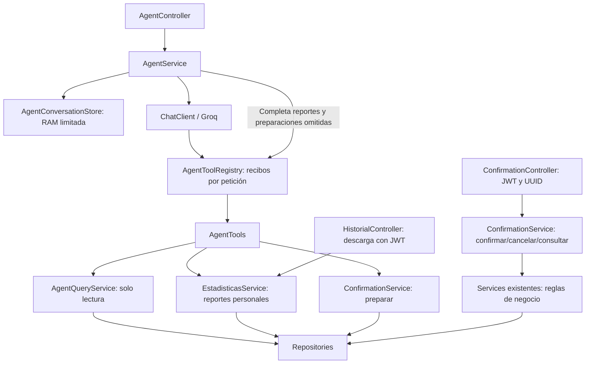

# Agente UniRide: flujo, contratos y pruebas manuales

Implementación vigente: Java 21, Spring Boot 4.1.1, Spring AI 2.0.2 y Groq mediante API compatible con OpenAI, modelo `openai/gpt-oss-120b`. No requiere una clave de OpenAI. Configurar únicamente `GROQ_API_KEY` en el entorno privado.

## Componentes y descubrimiento

Java genera el texto visible a partir del resumen de la operación, las páginas consultadas, los reportes ejecutados o un catálogo de preguntas aclaratorias. El texto libre del modelo puede orientar una aclaración. El backend exige un recibo para comunicar el estado de una escritura e intercepta las excepciones de los callbacks antes del procesador de Spring AI.

`@SpringBootApplication` escanea `com.uniride`. Spring descubre `AgentConfig`, crea el `ChatClient` e inyecta los componentes por constructor. No se instancia la configuración manualmente.



El modelo elige entre las dieciséis herramientas registradas. Las consultas recuperan datos autorizados, la herramienta de historial prepara una descarga y las escrituras preparan confirmaciones que se ejecutan mediante una petición HTTP explícita. `AgentToolRegistry` conserva el resultado real de cada callback y construye la parte estructurada de la respuesta con los datos entregados por Java.

El modelo responde en texto natural. No se usa `.entity(ChatResponse.class)` ni `response_format=json_schema` durante tool calling: Groq no admite Structured Outputs junto con herramientas. No existe una herramienta `json` y la validación de herramientas permanece activada. Ver [diagnóstico y fuentes](auditoria-hardening-agente-ia.md).

## Autenticación y permisos

Todas las rutas `/api/agent/**` requieren Bearer JWT válido de una cuenta verificada. La identidad procede de Spring Security y del usuario actual de la base, nunca de argumentos del modelo. Las pruebas conservan el comportamiento HTTP existente de SecurityConfig: sin token, inválido o expirado se responde 403; no se cambia globalmente el contrato de seguridad.

| Herramienta | Rol actual requerido |
|---|---|
| consultarMisRutas, consultarMisViajes, crearRuta, crearViaje | CONDUCTOR |
| buscarViajes, consultarMisSolicitudes, solicitarUnirse | PASAJERO |
| consultarMisMetodosCompensacion, registrarMetodoCompensacion | Ambos |
| actualizarMetodoCompensacion, cambiarEstadoMetodoCompensacion, eliminarMetodoCompensacion | Ambos |
| consultarMisEstadisticas, consultarMiFrecuenciaViajes | Ambos |
| consultarRankingMisRutas | CONDUCTOR |
| prepararDescargaHistorialPdf | Ambos |

La búsqueda de viajes respeta la restricción del controller tradicional a PASAJERO. El agente no cambia roles. La ejecución de confirmaciones comprueba nuevamente rol, propiedad, datos resumidos y reglas existentes.

## Conversación

```http
POST /api/agent/chat
Authorization: Bearer <token>
Content-Type: application/json
```

```json
{"message":"¿Cuáles son mis rutas?"}
```

Respuesta de consulta (IDs y contenidos son ilustrativos):

```json
{
  "message":"Se encontró 1 resultado en las páginas consultadas.",
  "viajes":[],
  "rutas":[{"rutaId":13,"origen":"Surco","destino":"UPC","puntosReferencia":"Parque","zonasSinParada":null,"capacidadMaxima":4,"estado":"ACTIVA"}],
  "metodosCompensacion":[],
  "operacion":null,
  "resultados":[{"tipo":"consultarMisRutas","datos":{"items":[{"rutaId":13,"origen":"Surco","destino":"UPC","puntosReferencia":"Parque","zonasSinParada":null,"capacidadMaxima":4,"estado":"ACTIVA"}],"pagina":0,"tamano":10,"total":1,"hayMas":false}}],
  "advertencia":null,
  "conversationId":"2c54e29b-701e-44af-a745-87aa311b9661"
}
```

Los cinco campos originales se conservan. `resultados` es un sobre extensible: `tipo` identifica la herramienta y `datos` contiene su resultado Java. Las listas originales siguen disponibles para los clientes existentes. Las futuras tools pueden agregar tipos sin crear campos vacíos de funcionalidades que aún no existen.

Continuar sesión:

```json
{"message":"Muéstrame la página siguiente","conversationId":"2c54e29b-701e-44af-a745-87aa311b9661"}
```

Omitir `conversationId` inicia una sesión independiente. El ID es aleatorio y está vinculado al usuario; uno ajeno o desconocido devuelve 404. La sesión vive en RAM, conserva como máximo 20 mensajes (diez intercambios), admite 100 peticiones y expira tras 30 minutos sin actividad. Limpieza cada minuto. Se permiten cinco sesiones por usuario (se desplaza la más antigua libre) y mil en total por instancia. Un mensaje simultáneo en la misma sesión devuelve 409. El cambio de rol invalida su contexto (409). Reiniciar la instancia elimina la memoria, sin afectar confirmaciones persistidas. No hay endpoint para recuperar historias ajenas. No enviar contraseñas, JWT ni claves; los patrones de credenciales reconocidos se rechazan antes de llamar al proveedor.

Las consultas paginadas de rutas, viajes, solicitudes y métodos devuelven diez elementos por página y `hayMas`. La primera página es cero y se admite hasta la página 10000. La selección para escribir filtra todos los criterios en SQL y comprueba dos coincidencias para detectar ambigüedad global. La fecha se aplica antes de limitar. Las rutas muestran el estado persistido.

## Reportes de viajes por chat

Las herramientas de reportes permiten consultar estadísticas del usuario autenticado y preparar la descarga de su historial en PDF. Envía una pregunta en lenguaje natural a `POST /api/agent/chat`. Los endpoints tradicionales siguen disponibles para consultar los datos directamente.

Groq puede finalizar correctamente con texto aunque haya omitido una herramienta solicitada. Antes de este ajuste, una petición explícita como «¿Cuáles son mis rutas más utilizadas como conductor?» podía terminar con la aclaración genérica y `resultados` vacío. Tras una respuesta final válida de Groq, Java reconoce intenciones explícitas de reportes en el mensaje actual y ejecuta los callbacks de reportes que falten. Conserva los recibos que ya existen, aplica el presupuesto y los permisos del mismo turno y arma la respuesta sin otra llamada a Groq.

La detección de reportes admite expresiones en español con y sin tildes y combinaciones claras. Las peticiones de reportes ambiguas, las referencias que dependen solo de turnos anteriores, el listado de rutas y la búsqueda de viajes siguen el flujo habitual. Los fallos del proveedor siguen su propio manejo de errores.

| Historia y herramienta | Servicio reutilizado | Endpoint tradicional | Roles activos |
|---|---|---|---|
| US19 `consultarMisEstadisticas` | `EstadisticasService.resumen()` | `GET /api/estadisticas` | CONDUCTOR y PASAJERO |
| US20 `consultarMiFrecuenciaViajes` | `EstadisticasService.analisisSemanal()` | `GET /api/estadisticas/semana` | CONDUCTOR y PASAJERO |
| US21 `consultarRankingMisRutas` | `EstadisticasService.rankingRutas()` | `GET /api/estadisticas/rutas` | CONDUCTOR |

- **US19.** Devuelve `viajesComoConductor`, `viajesComoPasajero`, `viajesCancelados` y `penalidadesAcumuladas`. Los dos primeros campos cuentan viajes completados. Java suma ambos para presentar el total. La consulta admite historiales vacíos y conserva los ceros devueltos por el servicio.
- **US20.** Agrupa el historial de viajes completados por día de la semana. Con al menos cinco viajes, `viajesPorDia` contiene los siete días, incluidos los de frecuencia cero. También permite consultar un día concreto o identificar los días de mayor frecuencia. Con menos de cinco, `suficientesDatos` es `false`, `viajesPorDia` queda vacío y se presenta el `mensaje` del servicio. `canceladosPorMi` y `canceladosPorTerceros` se conservan en ambos casos.
- **US21.** El callback valida el rol activo antes de invocar el servicio, que requiere cinco viajes completados como conductor. Si se invoca con rol `PASAJERO`, el chat devuelve HTTP 403. Con suficientes datos, cada entrada del `ranking` incluye `origen`, `destino`, `cantidad` de viajes completados y `penalidades` del conductor asociadas a esa combinación. Con menos de cinco se devuelve `suficientesDatos: false`, el `mensaje` de negocio y un ranking vacío.

Las estadísticas de US19, US20 y US21 abarcan todo el historial. Si la pregunta solicita una semana concreta, los últimos siete días u otro período para estas estadísticas, el agente presenta los datos con su alcance histórico e informa que la consulta carece de filtros por fechas. Las consultas de reportes son de solo lectura y una petición exclusiva de reportes devuelve `operacion: null`.

Cada consulta queda en `resultados` con el nombre de la herramienta en `tipo` y el DTO de estadísticas en `datos`. `message` resume esos datos e indica su alcance histórico. Cuando hay datos suficientes, el resumen de frecuencia muestra el desglose por día y destaca los días con más viajes. El resumen del ranking destaca las rutas con más viajes y las que registran más penalidades, y el cliente puede leer el ranking completo en `datos`. Un turno puede reunir varios reportes bajo el mismo `conversationId`.

Ejemplo de respuesta con cifras ilustrativas para `{"message":"¿Cuántos viajes he completado?"}`.

```json
{
  "message": "Has completado 12 viajes (8 como conductor y 4 como pasajero). También registras 2 viajes cancelados y 1 penalidad acumulada. Los reportes consultan todo tu historial y no admiten filtros por fechas.",
  "viajes": [],
  "rutas": [],
  "metodosCompensacion": [],
  "operacion": null,
  "resultados": [
    {
      "tipo": "consultarMisEstadisticas",
      "datos": {
        "viajesComoConductor": 8,
        "viajesComoPasajero": 4,
        "viajesCancelados": 2,
        "penalidadesAcumuladas": 1
      }
    }
  ],
  "advertencia": null,
  "conversationId": "2c54e29b-701e-44af-a745-87aa311b9661"
}
```

### Descarga del historial en PDF (US22)

`prepararDescargaHistorialPdf` está disponible para `CONDUCTOR` y `PASAJERO`. El chat devuelve un descriptor de descarga en `resultados`, con `tipo: "prepararDescargaHistorialPdf"`. El enlace apunta a `GET /api/historial/pdf`. El archivo se genera al ejecutar ese GET con el JWT del usuario y con los filtros del descriptor. La petición exclusiva de PDF es de solo lectura y devuelve `operacion: null`. Los bytes del PDF permanecen en la respuesta del endpoint autenticado.

Java interpreta el período y el tipo de viaje del mensaje actual. Los períodos relativos se calculan con la fecha de `America/Lima`.

| Petición | Límites inclusivos |
|---|---|
| Todo mi historial | Sin límites de fecha |
| Últimos 30 días | Desde hace 29 días hasta hoy |
| Mes pasado | Del primer al último día del mes calendario anterior |
| Este mes | Del primer día del mes actual hasta hoy |
| Octubre de 2026 | Del 1 al 31 de octubre de 2026 |
| Desde 2026-10-01 hasta 2026-10-15 | Del 1 al 15 de octubre de 2026 |

`tipo` admite `todos`, `conductor` y `pasajero`. Indica cómo participó el usuario en sus viajes y su valor predeterminado es `todos`. El enlace incluye siempre `tipo` y omite `desde` o `hasta` cuando falta ese límite. Ante un período ambiguo o inválido, el agente pide aclaración y omite el resultado PDF y su enlace. Por ejemplo, «último mes» requiere elegir entre el mes calendario pasado y los últimos 30 días. Las demás consultas válidas del mismo turno se conservan.

Ejemplo del elemento de `resultados` para «Quiero descargar mi historial de viajes en PDF de octubre de 2026».

```json
{
  "tipo": "prepararDescargaHistorialPdf",
  "datos": {
    "nombreArchivo": "historial-viajes.pdf",
    "urlDescarga": "/api/historial/pdf?desde=2026-10-01&hasta=2026-10-31&tipo=todos",
    "desde": "2026-10-01",
    "hasta": "2026-10-31",
    "tipo": "todos",
    "mensaje": "Preparé la solicitud para descargar tu historial de viajes del 1 de octubre de 2026 al 31 de octubre de 2026. El PDF se generará cuando solicites la descarga autenticada."
  }
}
```

`urlDescarga` es una ruta relativa al origen del backend y solo contiene los filtros de la descarga. El cliente envía el JWT en el encabezado `Authorization: Bearer <token>` de la petición GET. `/api/historial/pdf` identifica al usuario autenticado y genera el PDF con sus datos. Un GET válido devuelve `200` con `Content-Type: application/pdf` y `Content-Disposition: attachment`. Si el historial no tiene filas para esos filtros, devuelve `409`. Ante un JWT ausente o inválido, devuelve `403`. Ver [contrato del endpoint tradicional](endpoints.md#módulo-5--historial-y-estadísticas).

La integración pendiente de Angular podrá mostrar un botón «Descargar PDF» para el resultado de US22 y hacer un GET autenticado con `responseType: 'blob'`. `nombreArchivo` permite guardar el archivo con el nombre que indica el backend.

## Preparación y confirmación

```json
{"message":"Crea un viaje el 25 de noviembre de 2026 a las 08:00 en mi ruta de Surco"}
```

Si faltan datos o hay varias coincidencias, no se crea ninguna operación de negocio. El servidor puede devolver `operacion.estado` como `DATOS_FALTANTES`, `AMBIGUO`, `NO_ENCONTRADO`, `SIN_CAMBIOS` o `ERROR`. Una pregunta sin tool conserva listas vacías y `operacion:null`.

Cuando los datos son válidos, `operacion` es:

```json
{
  "estado":"CONFIRMACION_REQUERIDA",
  "id":null,
  "detalle":"Programar un viaje desde Surco hacia UPC el 2026-11-25 a las 08:00, capacidad 4. Referencias: Parque. ¿Confirmas esta operación?",
  "confirmacion":{
    "id":"f081920f-85ea-4f48-aafa-5abb11ae0077",
    "tipo":"CREAR_VIAJE",
    "estado":"PENDIENTE",
    "resumen":"Programar un viaje desde Surco hacia UPC el 2026-11-25 a las 08:00, capacidad 4. Referencias: Parque.",
    "parametros":{"fecha":"2026-11-25","hora":"08:00:00"},
    "expira":"2026-11-21T17:10:00Z",
    "resultado":null
  }
}
```

El frontend muestra `resumen` y botones Confirmar/Cancelar. El identificador y la expiración proceden del backend. La confirmación caduca a los diez minutos; se permiten veinte pendientes vigentes por usuario. Preparar solamente inserta metadatos de confirmación, sin rutas, viajes, solicitudes, métodos ni notificaciones de negocio.

```http
POST /api/agent/confirmaciones/f081920f-85ea-4f48-aafa-5abb11ae0077/confirmar
Authorization: Bearer <token>
```

La petición se envía sin cuerpo ni parámetros de consulta. El servidor utiliza exclusivamente los parámetros guardados. Cualquier cuerpo no vacío, incluso `{}`, recibe HTTP 400.

Si en la misma conversación el usuario responde solamente «sí» a una preparación reciente, el backend responde antes de llamar a Groq. Devuelve el mismo `conversationId`, `operacion: null` y `resultados: []`. El mensaje indica cómo usar el UUID original si la confirmación sigue pendiente, o avisa que se cumplió el plazo de la propuesta si su expiración ya pasó. Si el usuario cambia de tema antes de decir «sí», el chat ofrece orientación general y omite el UUID anterior. Para comprobar el estado efectivo de la confirmación persistida, usa `GET /api/agent/confirmaciones/{id}` con el UUID devuelto al preparar.

La respuesta es `ConfirmacionResumen`:

```json
{
  "id":"f081920f-85ea-4f48-aafa-5abb11ae0077",
  "tipo":"CREAR_VIAJE",
  "estado":"EJECUTADA",
  "resumen":"Programar un viaje desde Surco hacia UPC el 2026-11-25 a las 08:00, capacidad 4. Referencias: Parque.",
  "parametros":{"fecha":"2026-11-25","hora":"08:00:00"},
  "expira":"2026-11-21T17:10:00Z",
  "resultado":{"estado":"EXITO","id":42,"detalle":"Viaje programado para el 2026-11-25 a las 08:00.","confirmacion":null}
}
```

Se bloquea la confirmación propia y se ejecuta negocio más recibo en una sola transacción. Repetir el mismo ID ejecutado devuelve el resultado almacenado. No se crea una segunda operación. No hay reintentos automáticos de escrituras. Ante un fallo de conexión con resultado incierto, consultar primero el mismo ID; no preparar una acción nueva suponiendo que falló.

```http
GET /api/agent/confirmaciones/{id}
POST /api/agent/confirmaciones/{id}/cancelar
```

Ambos requieren JWT del propietario. Cancelar no recibe cuerpo ni parámetros. Devuelve el mismo sobre con `estado:"CANCELADA"`, `resultado:null`; cancelar otra vez no ejecuta nada. Cancelar una ejecutada o confirmar una cancelada devuelve 409. Una confirmación expirada devuelve 410 y su sobre con `estado:"EXPIRADA"`, `resultado:null`. Una ajena/inexistente da 404. Cambio de rol incompatible: 403. Cambio de ruta, destino de perfil, horario o estado frente al resumen: 409, preparar de nuevo. Fallo de reglas de negocio: 400/409 según la regla, rollback conjunto y confirmación pendiente.

Los tipos implementados son `CREAR_RUTA`, `CREAR_VIAJE`, `SOLICITAR_UNIRSE`, `REGISTRAR_METODO`, `ACTUALIZAR_METODO`, `CAMBIAR_ESTADO_METODO` y `ELIMINAR_METODO`.

### Gestión de métodos de compensación (US26–US28)

Los conductores y pasajeros pueden listar sus métodos y preparar el registro, la edición, el cambio de estado o la eliminación de un método. El chat permite identificar un método propio por su tipo (`DINERO`, `GASOLINA` o `FAVOR`), su descripción o ambos. La búsqueda por descripción ignora mayúsculas y prioriza las coincidencias exactas. Si no hay coincidencia exacta, busca el fragmento literal. Si hay varias coincidencias, se solicita una descripción más precisa. Un método ajeno se trata como inexistente.

| Herramienta | Acción disponible | Tipo de confirmación | Endpoint tradicional equivalente |
|---|---|---|---|
| `consultarMisMetodosCompensacion` | Consultar métodos propios | Consulta | `GET /api/metodos-compensacion` |
| `registrarMetodoCompensacion` | Registrar un método activo | `REGISTRAR_METODO` | `POST /api/metodos-compensacion` |
| `actualizarMetodoCompensacion` | Cambiar el tipo, la descripción o ambos y conservar el estado activo | `ACTUALIZAR_METODO` | `PUT /api/metodos-compensacion/{id}` |
| `cambiarEstadoMetodoCompensacion` | Activar o desactivar y conservar el tipo y la descripción | `CAMBIAR_ESTADO_METODO` | `PUT /api/metodos-compensacion/{id}` |
| `eliminarMetodoCompensacion` | Eliminar un método propio | `ELIMINAR_METODO` | `DELETE /api/metodos-compensacion/{id}` |

Una propuesta válida identifica el método actual, muestra los valores anteriores y propuestos cuando corresponda, y devuelve `operacion.estado: "CONFIRMACION_REQUERIDA"`. En una edición o cambio de estado, `operacion.confirmacion.parametros` contiene los valores propuestos de `tipo`, `descripcion` y `activo`. Para eliminar, `parametros` contiene `{}`. El servidor guarda internamente el método seleccionado y su estado al preparar. Al confirmar mediante HTTP, el backend compara ese estado con los datos actuales y vuelve a validar la propiedad y las reglas de negocio. Si el método cambió después de preparar la propuesta, el endpoint devuelve `409` y el usuario debe volver a solicitar el cambio. Repetir una confirmación ejecutada devuelve su recibo.

| `operacion.estado` | Motivo para omitir la confirmación |
|---|---|
| `DATOS_FALTANTES` | La petición carece de un selector o de un dato necesario para el cambio |
| `AMBIGUO` | Coinciden varios métodos propios |
| `NO_ENCONTRADO` | El usuario carece de un método que coincida |
| `SIN_CAMBIOS` | El cambio solicitado coincide con los valores actuales |
| `ERROR` | La edición duplicaría el tipo y la descripción de otro método propio o la eliminación afectaría a un método vinculado a cualquier solicitud |

Si un duplicado o un vínculo aparece entre la preparación y la confirmación, el endpoint devuelve `409`. La desactivación permite dejar de usar un método vinculado y conservarlo junto con su historial. El contrato tradicional se detalla en [Pagos y compensación](endpoints.md#módulo-7--pagos-y-compensación).

El backend contesta directamente las preguntas que identifica sobre los tipos de compensación y cómo gestionar un método. `DINERO` corresponde a aportes monetarios, `GASOLINA` a aportes de combustible y `FAVOR` a ayudas acordadas entre usuarios. Estas respuestas dan orientación en `message` sin consultar a Groq ni usar herramientas, con `operacion: null` y `resultados: []`. Las órdenes negadas, como «No desactives mi método Yape», bloquean la preparación.

Si la petición identifica con claridad una acción y contiene sus datos, Java puede completar una preparación de registro, edición, activación, desactivación o eliminación omitida por Groq después de una respuesta final válida. La llamada del modelo y la recuperación usan los argumentos comprobados en Java, el callback habitual, el presupuesto del turno y el límite de una preparación. `ConfirmationService` sigue seleccionando el método propio y aplicando las reglas de negocio. El cambio se aplica al confirmar por HTTP.

El registro, la edición y la eliminación pueden completarse en varios mensajes con el mismo `conversationId`. Ante una solicitud explícita incompleta, la sesión conserva los campos ya identificados y admite una respuesta breve con el dato que acaba de pedir. Si una edición o eliminación tiene varias coincidencias, el usuario puede precisar el método en la misma conversación. Un cambio de tema limpia el borrador. Para precisar una activación o desactivación, vuelve a indicar la acción junto con el método.

## Errores y recuperación

Error de proveedor sin resultados previos:

```json
{"mensaje":"El proveedor rechazó la respuesta o la llamada a una herramienta. No se reintentó la conversación.","campos":{"codigo":"PROVIDER_REJECTED"}}
```

| HTTP | Situación |
|---|---|
| 400 | Mensaje vacío/mayor a 1000, UUID mal formado, parámetros inválidos o credenciales en texto |
| 403 | JWT ausente/inválido/expirado o permiso insuficiente |
| 404 | Sesión/confirmación ajena, desconocida o sesión caducada |
| 409 | Sesión ocupada/cambio de rol, confirmación cancelada o datos/reglas cambiados |
| 410 | Confirmación expirada |
| 429 | Cuota del proveedor o límite de conversaciones |
| 502 | Herramienta desconocida/rechazada, respuesta inválida/vacía/incompleta |
| 503 | Proveedor no disponible, credencial Groq rechazada o conexión fallida |
| 504 | Timeout del proveedor |

Si la herramienta ya produjo un recibo antes del fallo del proveedor, se devuelve HTTP 200 con los datos existentes y `advertencia:{"codigo":"PROVIDER_REJECTED","mensaje":"..."}`. La confirmación pendiente sigue disponible en `operacion.confirmacion`. El cliente debe mostrar la advertencia y usar el estado real del backend. Nunca inferir éxito de escritura a partir de `message`. Cada turno permite como máximo ocho llamadas y una preparación; las llamadas idénticas del mismo turno usan su recibo. El cliente Groq no reintenta automáticamente; el timeout de cada solicitud es 30 segundos.

## Swagger y Postman

1. Arrancar con configuración privada de PostgreSQL, JWT y `GROQ_API_KEY`, tras revisar migraciones.
2. Iniciar sesión con una cuenta verificada mediante `/api/auth/login` y copiar el token de su respuesta al botón Authorize de Swagger (`/api/swagger-ui.html`) o al Bearer de Postman.
3. CONDUCTOR: «Consulta mis rutas», «Consulta mis viajes».
4. PASAJERO: «Busca viajes disponibles el viernes a las 07:00», «Consulta mis solicitudes».
5. Ambos: «Consulta mis métodos de compensación».
6. «Crea un viaje en mi ruta de Surco»: debe pedir fecha/hora, sin crear nada.
7. Preparar una escritura en una base local aislada, revisar el resumen y confirmar/cancelar mediante sus endpoints.
8. Para una prueba real con Groq sobre Supabase, utilizar únicamente consultas. No confirmar escrituras ni cambiar datos.

### Probar la gestión de métodos de compensación

En una base local aislada, autoriza Swagger como conductor o pasajero. Consulta los métodos propios mediante `GET /api/metodos-compensacion` o con esta petición a `POST /api/agent/chat`.

```json
{"message":"Consulta mis métodos de compensación"}
```

Comprueba que `resultados` contenga `tipo: "consultarMisMetodosCompensacion"` con `datos.items` y que `operacion` sea `null`. Para probar la orientación sobre tipos y procedimiento, envía cada pregunta por separado.

```json
{"message":"¿Qué tipos de compensación existen?"}
```

```json
{"message":"¿Cómo puedo registrar, actualizar o eliminar un método?"}
```

Comprueba que `message` responda la pregunta, `operacion` sea `null` y `resultados` esté vacío. Después, prueba cada cambio por separado con un tipo o descripción que identifique un único método propio.

```json
{"message":"Cambia la descripción de mi método Yape a Yape personal"}
```

```json
{"message":"Desactiva mi método Yape"}
```

```json
{"message":"Activa mi método de compensación gasolina"}
```

```json
{"message":"Elimina mi método FAVOR"}
```

Si `Yape` es un método `DINERO` activo, `GET /api/agent/confirmaciones/{id}` devuelve una propuesta con esta forma. Los valores entre `<` y `>` representan valores que genera el backend.

```json
{
  "id": "<uuid-devuelto>",
  "tipo": "ACTUALIZAR_METODO",
  "estado": "PENDIENTE",
  "resumen": "Actualizar tu método. Antes era DINERO «Yape» (activo). Quedará como DINERO «Yape personal» (activo).",
  "parametros": {"tipo":"DINERO","descripcion":"Yape personal","activo":true},
  "expira": "<expiracion-devuelta>",
  "resultado": null
}
```

1. Comprueba que `operacion.estado` sea `CONFIRMACION_REQUERIDA` y que `operacion.confirmacion.resumen` describa el método y el cambio. Copia exactamente el UUID que devolvió `operacion.confirmacion.id` para usarlo en el path del GET o del POST.
2. En ese mismo `conversationId`, envía «sí» al chat. Comprueba que `message` mencione la confirmación HTTP original, `operacion` sea `null` y `resultados` esté vacío. Repite `GET /api/metodos-compensacion` para comprobar que todavía están los datos originales.
3. Ejecuta `POST /api/agent/confirmaciones/{id}/confirmar` con el mismo JWT, sin cuerpo ni parámetros de consulta. Comprueba `estado: "EJECUTADA"` y `resultado.estado: "EXITO"`.
4. Vuelve a listar los métodos para comprobar el cambio. Repite la confirmación con el mismo UUID y verifica que devuelve el resultado guardado.

El POST de confirmación y las siguientes consultas GET devuelven el resultado ejecutado. En el ejemplo, `resultado.id` ilustra el identificador numérico del método que entrega el backend.

```json
{
  "id": "<uuid-devuelto>",
  "tipo": "ACTUALIZAR_METODO",
  "estado": "EJECUTADA",
  "resumen": "Actualizar tu método. Antes era DINERO «Yape» (activo). Quedará como DINERO «Yape personal» (activo).",
  "parametros": {"tipo":"DINERO","descripcion":"Yape personal","activo":true},
  "expira": "<expiracion-devuelta>",
  "resultado": {
    "estado": "EXITO",
    "id": 17,
    "detalle": "Método DINERO «Yape personal» (activo) actualizado.",
    "confirmacion": null
  }
}
```

Para probar la cancelación, prepara otra operación y ejecuta `POST /api/agent/confirmaciones/{id}/cancelar`. Verifica `estado: "CANCELADA"` y que los métodos conservan sus datos. También puedes probar una descripción ambigua, un método vinculado a una solicitud o una edición duplicada y comprobar que el chat omite la confirmación.

#### Registro en dos turnos

Envía este cuerpo a `POST /api/agent/chat` y comprueba que el agente pida la descripción.

```json
{"message":"Registra un método FAVOR"}
```

Copia el `conversationId` devuelto por el chat en la segunda petición.

```json
{"message":"Apuntes de clase","conversationId":"<conversationId-devuelto>"}
```

Comprueba que la confirmación corresponda a un método `FAVOR` llamado «Apuntes de clase». También puedes iniciar con `{"message":"Prefiero FAVOR, agrégalo"}` para que el chat pida la descripción antes de preparar la confirmación.

Después de recibir la propuesta, puedes comprobar el comportamiento de una afirmación aislada.

```json
{"message":"sí","conversationId":"<conversationId-devuelto>"}
```

Para ejecutar el registro, sigue el paso de confirmación HTTP con el UUID original de la propuesta. Si antes de decir «sí» envías otra petición, como «¿Qué tipos de compensación existen?», la afirmación recibe orientación general. Puedes seguir consultando la propuesta con el UUID que guardaste.

#### Edición y eliminación en dos turnos

Para editar la descripción, envía este cuerpo y comprueba que el chat pida la nueva descripción.

```json
{"message":"Cambia la descripción de mi método Yape"}
```

Reenvía el `conversationId` real que te entregó el chat.

```json
{"message":"Yape personal","conversationId":"<conversationId-devuelto>"}
```

Para eliminar un método, inicia otra conversación y comprueba que el chat pida su tipo o descripción.

```json
{"message":"Elimina mi método"}
```

Envía el dato pedido con el UUID de esa conversación.

```json
{"message":"Yape","conversationId":"<conversationId-devuelto>"}
```

Si el método existe, es identificable y cumple las reglas de la operación, el chat prepara la confirmación. Comprueba el cambio propuesto en `operacion.confirmacion.resumen` y usa su UUID para confirmar o cancelar por HTTP.

### Probar los reportes estadísticos

Para probar reportes, abre `POST /api/agent/chat` en Swagger, elige **Try it out** y ejecuta cada cuerpo por separado. Comprueba `message`, `conversationId`, `operacion: null` y el contenido de `resultados`.

```json
{"message":"¿Cuántos viajes he completado como conductor y como pasajero?"}
```

Busca `tipo: "consultarMisEstadisticas"` y compara los totales de `datos` con `GET /api/estadisticas`.

```json
{"message":"¿Cuántos viajes he realizado los lunes y qué día suelo viajar más?"}
```

Busca `tipo: "consultarMiFrecuenciaViajes"`. Con un historial suficiente, comprueba los siete días de `datos.viajesPorDia`, incluido el lunes.

```json
{"message":"¿Cuáles son mis rutas más utilizadas como conductor?"}
```

```json
{"message":"Muéstrame el ranking de mis rutas y cuáles tienen más penalidades."}
```

Busca `tipo: "consultarRankingMisRutas"`. Con un conductor que tenga al menos cinco viajes completados, compara `datos.ranking` con `GET /api/estadisticas/rutas` y verifica `origen`, `destino`, `cantidad` y `penalidades` de cada entrada. Con un conductor por debajo del mínimo, comprueba `datos.suficientesDatos: false`, `datos.mensaje` y el ranking vacío. Un pasajero que pide el ranking recibe HTTP 403 cuando se ejecuta el callback.

```json
{"message":"¿Cuántos viajes he completado y qué rutas tienen más penalidades?"}
```

Con un conductor, comprueba que `resultados` contiene un resultado de estadísticas y otro de ranking y que `message` utiliza los datos de ambos. Prueba también `{"message":"¿Cuál fue mi frecuencia de viajes en los últimos siete días?"}` para comprobar que la respuesta indica el alcance histórico y la limitación temporal.

### Probar el historial PDF

1. Autoriza Swagger con el JWT de un usuario verificado. Abre `POST /api/agent/chat` y prueba uno de estos cuerpos.

   ```json
   {"message":"Quiero descargar todo mi historial de viajes en PDF"}
   ```

   ```json
   {"message":"Quiero descargar mi historial de viajes en PDF de octubre de 2026"}
   ```

   ```json
   {"message":"Quiero descargar mi historial de viajes en PDF del mes pasado como pasajero"}
   ```

   ```json
   {"message":"¿Cuántos viajes he completado? También quiero descargar mi historial de viajes en PDF de los últimos 30 días."}
   ```

2. Busca `tipo: "prepararDescargaHistorialPdf"` y revisa `datos.urlDescarga`, `datos.nombreArchivo` y los filtros. En la petición combinada también se devuelve `tipo: "consultarMisEstadisticas"`.
3. Abre `GET /api/historial/pdf` en Swagger y copia los filtros de `datos`. Deja en blanco los límites de fecha que vengan vacíos. Ejecuta con el mismo JWT y verifica `200`, el tipo `application/pdf` y el archivo descargable. Con un historial vacío para los filtros, comprueba `409`.

Pruebas automáticas sin Groq ni Supabase: `mvnw.cmd clean test`, `mvnw.cmd verify`. PostgreSQL temporal: `powershell -File scripts/test-agent-postgres.ps1` (requiere binarios PostgreSQL; acepta `-PostgresBin`). El script crea una base nueva limitada a loopback, fuerza la configuración de pruebas, ejecuta `-Ppostgres-it test`, detiene el clúster y conserva sus archivos temporales para inspección. Nunca ejecutar `flyway clean`.
