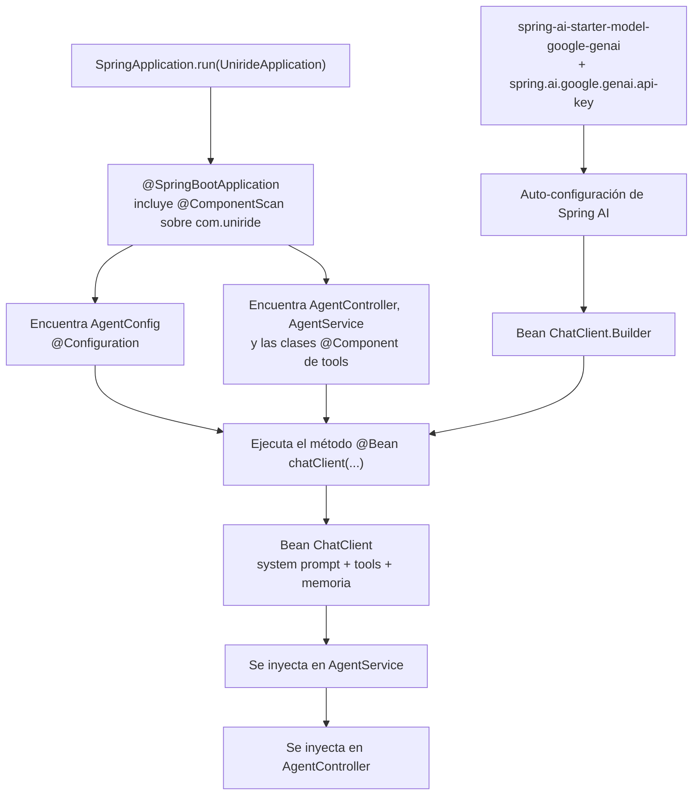
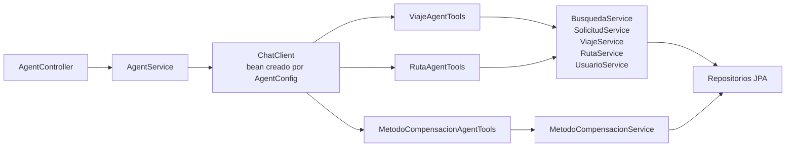
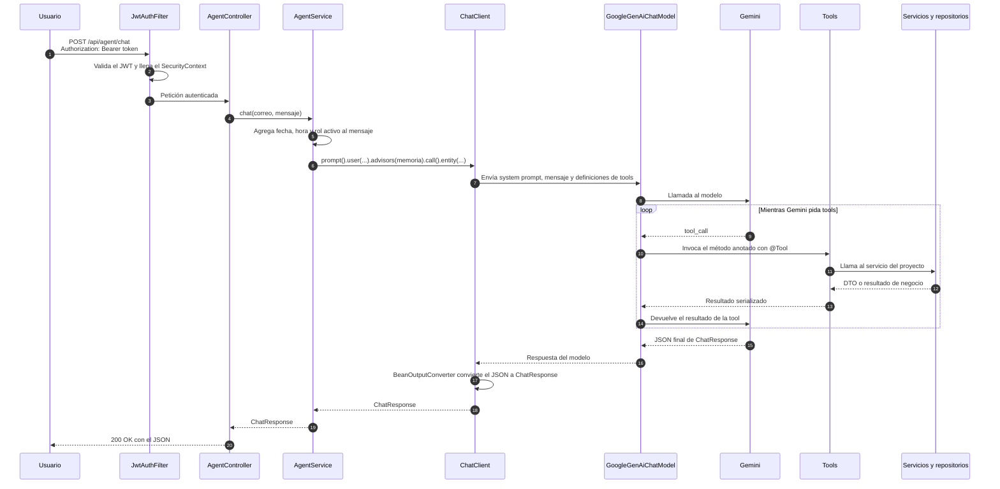

# Agente de IA: descubrimiento de beans y flujo de una petición

Este documento explica cómo se conecta el módulo `com.uniride.agent` con el resto de la aplicación y qué ocurre desde que llega un mensaje a `POST /api/agent/chat` hasta que se devuelve la respuesta.

## 1. Archivos que participan

| Archivo | Responsabilidad |
|---|---|
| `UnirideApplication.java` | Arranca Spring Boot y escanea el paquete `com.uniride` y sus subpaquetes. |
| `agent/AgentConfig.java` | Define el bean `ChatClient`, el system prompt, las tools y la memoria. |
| `agent/AgentController.java` | Recibe `POST /agent/chat` y obtiene el usuario autenticado. |
| `agent/AgentService.java` | Agrega el contexto de fecha/rol y llama al `ChatClient`. |
| `agent/tools/*.java` | Métodos anotados con `@Tool` que el modelo puede invocar. |
| `services/*.java` | Reglas de negocio reutilizadas por las tools. |
| `security/JwtAuthFilter.java` | Valida el JWT y llena el `SecurityContext`. |
| `exceptions/GlobalExceptionHandler.java` | Convierte errores del agente o del modelo en respuestas HTTP controladas. |

`AgentConfig` **no se importa** en `AgentService` ni en `AgentController`. La unión ocurre en tiempo de arranque mediante el contenedor de Spring.

## 2. Cómo se descubre `AgentConfig`

`UnirideApplication` está anotada con `@SpringBootApplication`:

```java
@SpringBootApplication
@EnableScheduling
public class UnirideApplication { ... }
```

`@SpringBootApplication` incluye `@ComponentScan`, que busca componentes en `com.uniride` y todos sus subpaquetes. Por eso encuentra automáticamente:

- `AgentConfig` porque tiene `@Configuration`.
- `AgentController` porque tiene `@RestController`.
- `AgentService` porque tiene `@Service`.
- `ViajeAgentTools`, `RutaAgentTools` y `MetodoCompensacionAgentTools` porque tienen `@Component`.



### El método `@Bean`

```java
@Configuration
public class AgentConfig {

    @Bean
    ChatClient chatClient(ChatClient.Builder builder, ViajeAgentTools viajeTools,
            RutaAgentTools rutaTools, MetodoCompensacionAgentTools metodoTools) {
        var memory = MessageWindowChatMemory.builder().maxMessages(20).build();
        return builder
                .defaultSystem(SYSTEM)
                .defaultTools(viajeTools, rutaTools, metodoTools)
                .defaultAdvisors(MessageChatMemoryAdvisor.builder(memory).build())
                .build();
    }
}
```

Al arrancar, Spring:

1. Detecta `AgentConfig` como configuración.
2. Ejecuta `chatClient(...)`.
3. Resuelve los parámetros por tipo desde el contenedor:
   - `ChatClient.Builder`: lo provee la auto-configuración de Spring AI.
   - Las tools: son beans `@Component` encontrados por el escaneo.
4. Registra el objeto devuelto como un bean de tipo `ChatClient`.

`defaultTools(...)` convierte los métodos anotados con `@Tool` en definiciones que se envían al modelo. Cuando Gemini decide usar una, **Spring AI ejecuta el método Java** del bean correspondiente. No hay una llamada manual a las tools desde `AgentService`.

### Inyección por constructor

`AgentService` solo declara el campo:

```java
@Service
@RequiredArgsConstructor
public class AgentService {
    private final ChatClient chatClient;
    private final UsuarioService usuarioService;
    private final Clock clock;
    ...
}
```

Lombok genera el constructor y Spring inyecta cada dependencia por tipo. No hay `new AgentConfig()` ni `AgentConfig.chatClient()`.

Lo mismo ocurre con `AgentController`:

```java
@RestController
@RequiredArgsConstructor
public class AgentController {
    private final AgentService agentService;
}
```

## 3. Dependencias entre componentes



## 4. Flujo completo de una petición



## 5. Ejemplo de petición y respuesta

```http
POST /api/agent/chat
Authorization: Bearer <token>
Content-Type: application/json
```

```json
{
  "message": "¿Hay viajes el viernes a las 7?"
}
```

```json
{
  "message": "Encontré un viaje el viernes a las 07:00 de Surco a UPC.",
  "viajes": [
    {
      "viajeId": 12,
      "rutaId": 3,
      "origen": "Surco",
      "destino": "UPC",
      "dia": "Viernes",
      "fecha": "2026-11-20",
      "hora": "07:00",
      "puntosReferencia": "Parque",
      "conductorNombre": "Juan",
      "capacidadMaxima": 4,
      "estado": null,
      "estadoSolicitud": null
    }
  ],
  "rutas": [],
  "metodosCompensacion": [],
  "operacion": null
}
```

## 6. Detalles de comportamiento

- **Seguridad:** `SecurityConfig` deja `/agent/**` dentro de `anyRequest().authenticated()`. No hay `permitAll` para el agente.
- **Identidad:** el correo sale del `Authentication` que construyó `JwtAuthFilter`. Se usa para la memoria de conversación y para que `UsuarioService.usuarioActual()` resuelva al usuario.
- **Memoria:** `MessageWindowChatMemory` guarda los últimos 20 mensajes por correo. Vive en RAM y se pierde al reiniciar.
- **Unirse a un viaje:** `solicitarUnirse` llama directamente a `SolicitudService.crear`. La solicitud queda `PENDIENTE` y el conductor decide si la acepta o rechaza. El agente no confirma ni acepta solicitudes.
- **Errores de negocio:** las tools de escritura capturan `BusinessException`, `CamposInvalidosException`, `ResourceNotFoundException` y `NoPermitidoException`, y devuelven `OperacionResumen(ERROR, ...)` para que el modelo lo explique.
- **Respuesta inválida del modelo:** si Gemini responde texto en vez del JSON esperado, `BeanOutputConverter` lanza `JacksonException` y `GlobalExceptionHandler` responde `502 BAD_GATEWAY`.
- **Tests:** `src/test/resources/application.yml` define una `api-key` dummy para que el contexto de pruebas no dependa de `GEMINI_API_KEY`.

## 7. Cómo probarlo desde Postman

### 7.1 Preparación

1. Arranca la aplicación con `GEMINI_API_KEY` configurada en el `.env`.
2. En Postman crea un entorno con estas variables:

| Variable | Valor inicial |
|---|---|
| `baseUrl` | `http://localhost:8080/api` |
| `token` | vacío |
| `tokenConductor` | vacío |
| `tokenPasajero` | vacío |
| `correoConductor` | correo de una cuenta con rol conductor |
| `correoPasajero` | correo de una cuenta con rol pasajero |

3. Usa cuentas **verificadas**. El login rechaza cuentas con `cuentaVerificada = false`. Si necesitas crear una, primero llama a `POST /auth/registro` y luego a `POST /auth/verificar` con el código de seis dígitos.

### 7.2 Obtener el token (login)

Request:

```http
POST {{baseUrl}}/auth/login
Content-Type: application/json
```

```json
{
  "correo": "{{correoConductor}}",
  "contrasena": "TuPassword1"
}
```

En la pestaña **Tests** de Postman:

```javascript
const respuesta = pm.response.json();

pm.test("Login correcto", () => {
  pm.response.to.have.status(200);
});

pm.environment.set("tokenConductor", respuesta.token);
```

Repite el login con la cuenta pasajera y guarda el token en `tokenPasajero`. Para pruebas rápidas de un solo usuario puedes usar `token`.

### 7.3 Llamar al agente

Request:

```http
POST {{baseUrl}}/agent/chat
Authorization: Bearer {{token}}
Content-Type: application/json
```

Body (raw → JSON):

```json
{
  "message": "¿Hay viajes el viernes a las 7?"
}
```

En la pestaña **Tests**:

```javascript
const respuesta = pm.response.json();

pm.test("HTTP 200", () => {
  pm.response.to.have.status(200);
});

pm.test("El agente respondió", () => {
  pm.expect(respuesta.message).to.be.a("string").and.not.empty;
});

if (respuesta.operacion) {
  pm.test("Operación exitosa", () => {
    pm.expect(respuesta.operacion.estado).to.eql("EXITO");
  });
}
```

`operacion` es `null` en consultas y tiene valor en escrituras. Los errores de negocio no cambian el HTTP: llegan como `operacion.estado = "ERROR"` y un `detalle` explicando el motivo.

### 7.4 Mensajes de ejemplo por objetivo

| Objetivo | Token | `message` sugerido |
|---|---|---|
| Buscar viajes | pasajero o conductor | `"¿Qué viajes hay el viernes a las 7?"` |
| Consultar mis viajes | conductor | `"Muéstrame mis viajes como conductor"` |
| Consultar mis solicitudes | pasajero | `"¿Cuáles son mis solicitudes de viaje?"` |
| Consultar mis rutas | conductor | `"¿Cuáles son mis rutas?"` |
| Consultar mis métodos | cualquiera | `"¿Qué métodos de compensación tengo?"` |
| Crear ruta | conductor | `"Crea una ruta desde Surco con capacidad 4 y puntos de referencia el parque"` |
| Crear viaje | conductor | `"Crea un viaje en mi ruta Surco para el 20/11/2026 a las 07:00"` |
| Unirse a un viaje | pasajero | `"Quiero unirme al viaje del viernes a las 7 de Surco a UPC, compenso con GASOLINA"` |
| Registrar método | cualquiera | `"Registra mi método GASOLINA: Yape 999888777"` |

Notas:

- `crearViaje` exige una fecha futura con al menos 12 horas de anticipación.
- `crearRuta` exige que el conductor tenga una universidad registrada en su perfil.
- Un conductor no puede unirse a un viaje de su propia ruta; para probar el flujo de unión usa dos cuentas.
- Para unirse, el agente pedirá `DINERO`, `GASOLINA` o `FAVOR` si no lo mencionaste.
- `solicitarUnirse` envía la solicitud y queda `PENDIENTE`; el conductor la acepta o rechaza desde la aplicación. El agente no la acepta.

### 7.5 Flujo completo con dos usuarios

1. Login con la cuenta conductora → guarda `tokenConductor`.
2. Chat con `Authorization: Bearer {{tokenConductor}}` para crear una ruta y un viaje.
3. Login con la cuenta pasajera → guarda `tokenPasajero`.
4. Chat con `Authorization: Bearer {{tokenPasajero}}` para buscar el viaje y unirse.
5. Login nuevamente como conductor, consulta `GET /api/viajes/{viajeId}/solicitudes` y acepta con `PUT /api/solicitudes/{id}/aceptar`.

### 7.6 Probar desde la terminal

```bash
curl -X POST http://localhost:8080/api/agent/chat \
  -H "Authorization: Bearer $TOKEN" \
  -H "Content-Type: application/json" \
  -d '{"message":"¿Qué viajes hay el viernes a las 7?"}'
```

### 7.7 Errores comunes

| Respuesta | Causa probable |
|---|---|
| `401 Unauthorized` | Falta el header `Authorization` o el token expiró. |
| `400 Bad Request` | `message` vacío o supera 1000 caracteres. |
| `502 Bad Gateway` | El modelo respondió algo que no era el JSON de `ChatResponse`. Reintenta. |
| `200` con `operacion.estado = "DATOS_FALTANTES"` | El agente necesita más datos; responde en el siguiente mensaje. |
| `200` con `operacion.estado = "AMBIGUO"` | Varios viajes o rutas coinciden; indica fecha, hora o destino exacto. |
| `200` con `operacion.estado = "ERROR"` | Regla de negocio: rol incorrecto, sin cupo, sin perfil, duplicado, etc. Revisa `detalle`. |

## 8. Cuándo habría que importar `AgentConfig`

Mientras `AgentConfig` esté dentro de `com.uniride` o un subpaquete, no hay que importarlo. Si se mueve a otro paquete fuera del escaneo, habría que:

- agregar `@Import(AgentConfig.class)` en una configuración, o
- ampliar el `@ComponentScan` para incluir el nuevo paquete.

Sin ese paso, Spring no ejecutaría el método `@Bean`, no existiría el bean `ChatClient` y `AgentService` fallaría al arrancar por no poder inyectar su dependencia.
