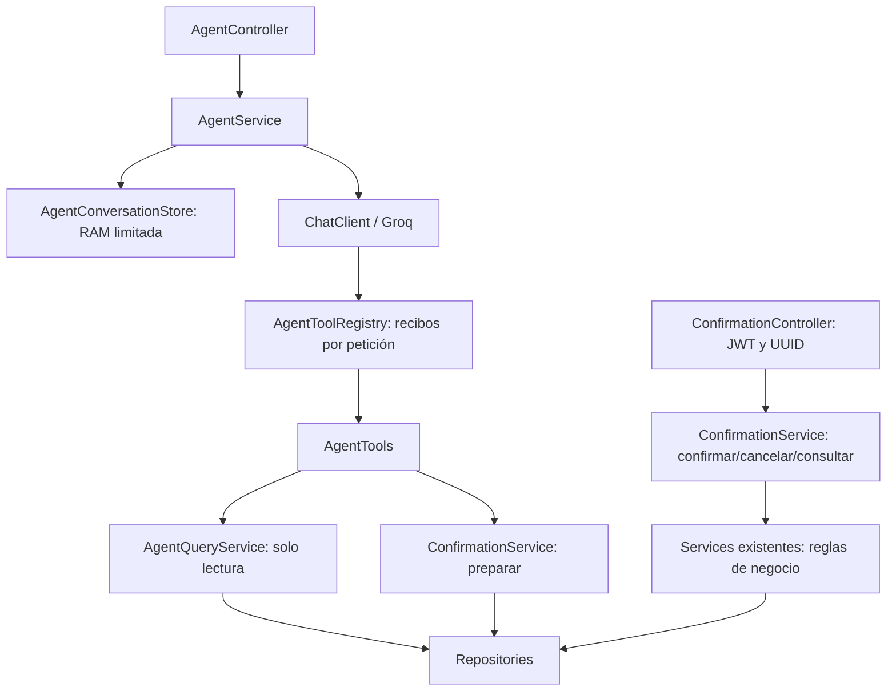

# Agente UniRide: flujo, contratos y pruebas manuales

Implementación vigente: Java 21, Spring Boot 4.1.1, Spring AI 2.0.2 y Groq mediante API compatible con OpenAI, modelo `openai/gpt-oss-120b`. No requiere una clave de OpenAI. Configurar únicamente `GROQ_API_KEY` en el entorno privado.

## Componentes y descubrimiento

El texto visible se controla en Java: resumen de la operación, conteo paginado o preguntas aclaratorias de un catálogo. La salida libre del modelo solo orienta el tema de la pregunta; no puede afirmar una escritura sin recibo. Las excepciones de callbacks se interceptan antes del procesador de Spring AI para no enviar errores internos al proveedor.

`@SpringBootApplication` escanea `com.uniride`. Spring descubre `AgentConfig`, crea el `ChatClient` e inyecta los componentes por constructor. No se instancia la configuración manualmente.



El modelo elige entre las nueve herramientas registradas. Las consultas recuperan datos autorizados; las escrituras preparan una confirmación. Ninguna herramienta confirma. `AgentToolRegistry` conserva el resultado real de cada callback y construye la parte estructurada de la respuesta. El texto del modelo no proporciona IDs, estados ni listas al contrato HTTP.

El modelo responde en texto natural. No se usa `.entity(ChatResponse.class)` ni `response_format=json_schema` durante tool calling: Groq no admite Structured Outputs junto con herramientas. No existe una herramienta `json` y la validación de herramientas permanece activada. Ver [diagnóstico y fuentes](auditoria-hardening-agente-ia.md).

## Autenticación y permisos

Todas las rutas `/api/agent/**` requieren Bearer JWT válido de una cuenta verificada. La identidad procede de Spring Security y del usuario actual de la base, nunca de argumentos del modelo. Las pruebas conservan el comportamiento HTTP existente de SecurityConfig: sin token, inválido o expirado se responde 403; no se cambia globalmente el contrato de seguridad.

| Herramienta | Rol actual requerido |
|---|---|
| consultarMisRutas, consultarMisViajes, crearRuta, crearViaje | CONDUCTOR |
| buscarViajes, consultarMisSolicitudes, solicitarUnirse | PASAJERO |
| consultarMisMetodosCompensacion, registrarMetodoCompensacion | Ambos |

La búsqueda de viajes respeta la restricción del controller tradicional a PASAJERO. El agente no cambia roles. La ejecución de confirmaciones comprueba nuevamente rol, propiedad, datos resumidos y reglas existentes.

## Conversación

```http
POST /api/agent/chat
Authorization: Bearer <token>
Content-Type: application/json
```

```json
{"message":"¿Cuáles son mis rutas?"}
```

Respuesta de consulta (IDs y contenidos son ilustrativos):

```json
{
  "message":"Se encontró 1 resultado en las páginas consultadas.",
  "viajes":[],
  "rutas":[{"rutaId":13,"origen":"Surco","destino":"UPC","puntosReferencia":"Parque","zonasSinParada":null,"capacidadMaxima":4,"estado":"ACTIVA"}],
  "metodosCompensacion":[],
  "operacion":null,
  "resultados":[{"tipo":"consultarMisRutas","datos":{"items":[{"rutaId":13,"origen":"Surco","destino":"UPC","puntosReferencia":"Parque","zonasSinParada":null,"capacidadMaxima":4,"estado":"ACTIVA"}],"pagina":0,"tamano":10,"total":1,"hayMas":false}}],
  "advertencia":null,
  "conversationId":"2c54e29b-701e-44af-a745-87aa311b9661"
}
```

Los cinco campos originales se conservan. `resultados` es un sobre extensible: `tipo` identifica la herramienta y `datos` contiene su resultado Java. Las listas originales siguen disponibles para los clientes existentes. Las futuras tools pueden agregar tipos sin crear campos vacíos de funcionalidades que aún no existen.

Continuar sesión:

```json
{"message":"Muéstrame la página siguiente","conversationId":"2c54e29b-701e-44af-a745-87aa311b9661"}
```

Omitir `conversationId` inicia una sesión independiente. El ID es aleatorio y está vinculado al usuario; uno ajeno o desconocido devuelve 404. La sesión vive en RAM, conserva como máximo 20 mensajes (diez intercambios), admite 100 peticiones y expira tras 30 minutos sin actividad. Limpieza cada minuto. Se permiten cinco sesiones por usuario (se desplaza la más antigua libre) y mil en total por instancia. Un mensaje simultáneo en la misma sesión devuelve 409. El cambio de rol invalida su contexto (409). Reiniciar la instancia elimina la memoria, sin afectar confirmaciones persistidas. No hay endpoint para recuperar historias ajenas. No enviar contraseñas, JWT ni claves; los patrones de credenciales reconocidos se rechazan antes de llamar al proveedor.

Las herramientas devuelven diez elementos por página y `hayMas`; la primera página es cero. Se admite hasta la página 10000 por protección de coste. No se carga toda la base. La selección para escribir filtra todos los criterios en SQL y comprueba dos coincidencias para detectar ambigüedad global. La fecha se aplica antes de limitar. Las rutas muestran el estado persistido: el agente no dispara la sincronización de estados del endpoint tradicional.

## Preparación y confirmación

```json
{"message":"Crea un viaje el 25 de noviembre de 2026 a las 08:00 en mi ruta de Surco"}
```

Si faltan datos o hay varias coincidencias, no se crea ninguna operación de negocio. El servidor puede devolver `operacion.estado` como `DATOS_FALTANTES`, `AMBIGUO`, `NO_ENCONTRADO` o `ERROR`. Una pregunta sin tool conserva listas vacías y `operacion:null`.

Cuando los datos son válidos, `operacion` es:

```json
{
  "estado":"CONFIRMACION_REQUERIDA",
  "id":null,
  "detalle":"Programar un viaje desde Surco hacia UPC el 2026-11-25 a las 08:00, capacidad 4. Referencias: Parque. ¿Confirmas esta operación?",
  "confirmacion":{
    "id":"f081920f-85ea-4f48-aafa-5abb11ae0077",
    "tipo":"CREAR_VIAJE",
    "estado":"PENDIENTE",
    "resumen":"Programar un viaje desde Surco hacia UPC el 2026-11-25 a las 08:00, capacidad 4. Referencias: Parque.",
    "parametros":{"fecha":"2026-11-25","hora":"08:00:00"},
    "expira":"2026-11-21T17:10:00Z",
    "resultado":null
  }
}
```

El frontend muestra `resumen` y botones Confirmar/Cancelar. El identificador y la expiración proceden del backend. La confirmación caduca a los diez minutos; se permiten veinte pendientes vigentes por usuario. Preparar solamente inserta metadatos de confirmación, sin rutas, viajes, solicitudes, métodos ni notificaciones de negocio.

```http
POST /api/agent/confirmaciones/f081920f-85ea-4f48-aafa-5abb11ae0077/confirmar
Authorization: Bearer <token>
```

No enviar cuerpo ni query parameters. El servidor utiliza exclusivamente los parámetros guardados; cualquier cuerpo no vacío, incluso `{}`, se rechaza con 400. Decir «sí» al modelo no ejecuta nada.

La respuesta es `ConfirmacionResumen`:

```json
{
  "id":"f081920f-85ea-4f48-aafa-5abb11ae0077",
  "tipo":"CREAR_VIAJE",
  "estado":"EJECUTADA",
  "resumen":"Programar un viaje desde Surco hacia UPC el 2026-11-25 a las 08:00, capacidad 4. Referencias: Parque.",
  "parametros":{"fecha":"2026-11-25","hora":"08:00:00"},
  "expira":"2026-11-21T17:10:00Z",
  "resultado":{"estado":"EXITO","id":42,"detalle":"Viaje programado para el 2026-11-25 a las 08:00.","confirmacion":null}
}
```

Se bloquea la confirmación propia y se ejecuta negocio más recibo en una sola transacción. Repetir el mismo ID ejecutado devuelve el resultado almacenado. No se crea una segunda operación. No hay reintentos automáticos de escrituras. Ante un fallo de conexión con resultado incierto, consultar primero el mismo ID; no preparar una acción nueva suponiendo que falló.

```http
GET /api/agent/confirmaciones/{id}
POST /api/agent/confirmaciones/{id}/cancelar
```

Ambos requieren JWT del propietario. Cancelar no recibe cuerpo ni parámetros. Devuelve el mismo sobre con `estado:"CANCELADA"`, `resultado:null`; cancelar otra vez no ejecuta nada. Cancelar una ejecutada o confirmar una cancelada devuelve 409. Una confirmación expirada devuelve 410 y su sobre con `estado:"EXPIRADA"`, `resultado:null`. Una ajena/inexistente da 404. Cambio de rol incompatible: 403. Cambio de ruta, destino de perfil, horario o estado frente al resumen: 409, preparar de nuevo. Fallo de reglas de negocio: 400/409 según la regla, rollback conjunto y confirmación pendiente.

Los tipos implementados son `CREAR_RUTA`, `CREAR_VIAJE`, `SOLICITAR_UNIRSE` y `REGISTRAR_METODO`. No se incorporan herramientas de perfil, horarios, reportes ni coordinación.

## Errores y recuperación

Error de proveedor sin resultados previos:

```json
{"mensaje":"El proveedor rechazó la respuesta o la llamada a una herramienta. No se reintentó la conversación.","campos":{"codigo":"PROVIDER_REJECTED"}}
```

| HTTP | Situación |
|---|---|
| 400 | Mensaje vacío/mayor a 1000, UUID mal formado, parámetros inválidos o credenciales en texto |
| 403 | JWT ausente/inválido/expirado o permiso insuficiente |
| 404 | Sesión/confirmación ajena, desconocida o sesión caducada |
| 409 | Sesión ocupada/cambio de rol, confirmación cancelada o datos/reglas cambiados |
| 410 | Confirmación expirada |
| 429 | Cuota del proveedor o límite de conversaciones |
| 502 | Herramienta desconocida/rechazada, respuesta inválida/vacía/incompleta |
| 503 | Proveedor no disponible, credencial Groq rechazada o conexión fallida |
| 504 | Timeout del proveedor |

Si la herramienta ya produjo un recibo antes del fallo del proveedor, se devuelve HTTP 200 con los datos existentes y `advertencia:{"codigo":"PROVIDER_REJECTED","mensaje":"..."}`. La confirmación pendiente sigue disponible en `operacion.confirmacion`. El cliente debe mostrar la advertencia y usar el estado real del backend. Nunca inferir éxito de escritura a partir de `message`. Cada turno permite como máximo ocho llamadas y una preparación; las llamadas idénticas del mismo turno usan su recibo. El cliente Groq no reintenta automáticamente; el timeout de cada solicitud es 30 segundos.

## Swagger y Postman

1. Arrancar con configuración privada de PostgreSQL, JWT y `GROQ_API_KEY`, tras revisar migraciones.
2. Iniciar sesión con una cuenta verificada mediante `/api/auth/login` y copiar el token de su respuesta al botón Authorize de Swagger (`/api/swagger-ui.html`) o al Bearer de Postman.
3. CONDUCTOR: «Consulta mis rutas», «Consulta mis viajes».
4. PASAJERO: «Busca viajes disponibles el viernes a las 07:00», «Consulta mis solicitudes».
5. Ambos: «Consulta mis métodos de compensación».
6. «Crea un viaje en mi ruta de Surco»: debe pedir fecha/hora, sin crear nada.
7. Preparar una escritura en una base local aislada, revisar el resumen y confirmar/cancelar mediante sus endpoints.
8. Para una prueba real con Groq sobre Supabase, utilizar únicamente consultas. No confirmar escrituras ni cambiar datos.

Pruebas automáticas sin Groq ni Supabase: `mvnw.cmd clean test`, `mvnw.cmd verify`. PostgreSQL temporal: `powershell -File scripts/test-agent-postgres.ps1` (requiere binarios PostgreSQL; acepta `-PostgresBin`). El script crea una base nueva limitada a loopback, fuerza la configuración de pruebas, ejecuta `-Ppostgres-it test`, detiene el clúster y conserva sus archivos temporales para inspección. Nunca ejecutar `flyway clean`.
