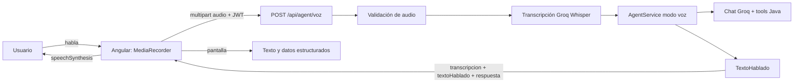

# Agente UniRide por voz: diseño, flujo y contrato

Estado: **implementado en el backend**. La grabación, el envío y el TTS viven en el repo
Angular y se implementan aparte; este documento es el contrato entre ambos. Describe el MVP: voz por turnos (push-to-talk)
en Angular de escritorio, transcripción con Groq y respuesta hablada con la Web Speech API del
navegador.

## 1. Alcance

Incluido:

- El usuario habla y el agente responde por voz, manteniendo el chat de texto existente.
- Transcripción en el backend con Groq (`whisper-large-v3-turbo`), reutilizando `GROQ_API_KEY`.
- Síntesis de voz en el navegador con `speechSynthesis` (costo cero, sin clave nueva).
- Lectura en voz alta del mensaje y de los resultados estructurados relevantes (rutas, viajes,
  métodos de compensación y sugerencias de contribución), sin depender de que el modelo los enumere.

Fuera de alcance por ahora:

- Conversación manos libres, detección de silencio, wake word o interrupción continua.
- APIs realtime (OpenAI Realtime, Gemini Live, ElevenLabs Agents), que reemplazarían el control
  de herramientas y confirmaciones que hoy vive en Java.
- TTS de servidor (ElevenLabs, Azure, OpenAI) y voz consistente entre dispositivos.
- Aplicación móvil; el objetivo es Angular de escritorio.

## 2. Decisiones acordadas

| Tema               | Decisión                                                                        |
| ------------------ | ------------------------------------------------------------------------------- |
| Interacción        | Push-to-talk: el usuario mantiene o alterna el botón, habla y suelta.           |
| STT                | Groq Whisper en el backend, misma clave y `base-url` del chat.                  |
| TTS                | Web Speech API del navegador, `es-PE` / `es-MX` / `es-ES` según disponibilidad. |
| Resultados         | El backend genera `textoHablado` con el mensaje y un resumen de las listas.     |
| Confirmaciones     | Se mantiene la lógica Java actual; la UI pide respuestas exactas «sí» o «no».   |
| Persistencia       | Sin cambios de base de datos. El audio no se guarda ni se registra en logs.     |
| Contrato existente | `POST /agent/chat` no cambia. La voz usa un endpoint nuevo.                     |

## 3. Arquitectura y flujo



Secuencia de un turno:

1. El usuario pulsa el micrófono; Angular pide permiso si es la primera vez.
2. Angular graba con `MediaRecorder` y corta automáticamente a los 30 s.
3. Al soltar, envía `POST /api/agent/voz` con el audio y el `conversationId` actual.
4. El backend valida JWT (lo hace Spring Security antes del controlador), tamaño, formato y
   contenido mínimo; rechaza audio inválido sin llamar a Groq.
5. El backend transcribe en memoria con Groq (`language=es`, `temperature=0`, prompt con
   vocabulario de UniRide).
6. El servidor valida la transcripción: no vacía, máximo 1000 caracteres y sin secretos.
7. `AgentService` procesa el texto con el mismo flujo de `/agent/chat`, pero en modo voz: el
   modelo responde en dos frases y no enumera listas.
8. El backend construye `textoHablado` con el mensaje y hasta cinco elementos por lista
   estructurada. Para US29 usa el importe por pasajero, el equivalente en gasolina y la
   cantidad de pasajeros del resultado verificado. El texto se limita a 900 caracteres.
9. Angular muestra la transcripción como mensaje del usuario, pinta la respuesta completa
   (`respuesta`) y reproduce `textoHablado`.
10. Si el usuario vuelve a pulsar el micrófono, Angular detiene la voz en curso (barge-in).

## 4. Contrato del backend

### 4.1 Request

```http
POST /api/agent/voz
Authorization: Bearer <JWT>
Content-Type: multipart/form-data
```

| Campo            | Tipo    | Obligatorio | Reglas                                    |
| ---------------- | ------- | ----------- | ----------------------------------------- |
| `audio`          | binario | Sí          | 1 KB–2 MB; Angular corta a 30 s           |
| `conversationId` | UUID    | No          | Continuar una conversación de voz o texto |

Formatos aceptados: `audio/webm`, `video/webm`, `audio/ogg`, `audio/mp4`, `audio/m4a`,
`audio/x-m4a`, `audio/wav`, `audio/x-wav`, `audio/mpeg` y `audio/mp3`. Si el MIME no es
concluyente, se usa la extensión del archivo.

Notas para Angular:

- No fijar `Content-Type` manualmente; el navegador debe agregar el `boundary` del multipart.
- Enviar siempre el header `Authorization`.
- Reutilizar el `conversationId` devuelto en la respuesta anterior; omitirlo abre una
  conversación nueva.
- La identidad y el rol salen del JWT, nunca del audio ni del cuerpo.

### 4.2 Respuesta exitosa

HTTP 200 con un envoltorio nuevo que conserva intacto el contrato de `/agent/chat`:

```json
{
  "transcripcion": "¿Cuáles son mis rutas?",
  "textoHablado": "Tienes dos rutas registradas. Tus rutas son: de Surco a UPC, activa; de San Miguel a UPC, llena.",
  "respuesta": {
    "message": "Tienes dos rutas registradas.",
    "viajes": [],
    "rutas": [
      { "rutaId": 7, "origen": "Surco", "destino": "UPC", "estado": "ACTIVA" },
      {
        "rutaId": 9,
        "origen": "San Miguel",
        "destino": "UPC",
        "estado": "LLENA"
      }
    ],
    "metodosCompensacion": [],
    "operacion": null,
    "resultados": [],
    "advertencia": null,
    "conversationId": "7f4c2b0e-7a3d-4f4e-9a2e-1f0f2f6c9d11"
  }
}
```

| Campo           | Uso en el frontend                                                                                                                        |
| --------------- | ----------------------------------------------------------------------------------------------------------------------------------------- |
| `transcripcion` | Mostrarla como mensaje del usuario; permite corregir errores del STT.                                                                     |
| `textoHablado`  | Reproducirla tal cual con `speechSynthesis`. Si falta o está vacía, usar `respuesta.message`.                                             |
| `respuesta`     | Mismo `ChatResponse` de `/agent/chat` con `message`, listas tipadas, `resultados`, `operacion`, `advertencia`, `conversationId` y `resolucionConfirmacion` cuando aplica. |

Reglas de `textoHablado`:

- Se genera en el backend; el frontend no compone ni resume listas por su cuenta.
- Incluye hasta 5 rutas, 5 viajes y 5 métodos. Si hay más, agrega «Hay N más en pantalla».
- Incluye una frase adicional si alguna página de resultados trae `hayMas`.
- No incluye IDs, JSON, markdown ni tablas.
- Puede incluir el aviso de confirmación generado por Java. La UI no debe interpretar ese
  texto para decidir acciones; solo lo muestra y lo lee.

Para probar una sugerencia en Swagger, autoriza un JWT con rol `PASAJERO` y adjunta a
`POST /api/agent/voz` un audio con «¿Cuánto tendría que aportar por un viaje de Surco a la UPC?».
Si necesitas completar la fecha, la hora o los pasajeros, reutiliza `respuesta.conversationId`
en la siguiente petición de voz o en el chat de texto. El resultado aparece en
`respuesta.resultados` con el tipo `sugerirContribucionViaje`. La respuesta hablada incluye
el importe, los pasajeros usados y el carácter referencial sujeto a acuerdo. La sugerencia
es informativa y no requiere confirmación. [Contrato y ejemplos de US29](agente_flujo.md#sugerencia-de-contribución-us29)

### 4.3 Errores

Se reutiliza `ErrorRespuesta`: `{"mensaje": "...", "campos": {"codigo": "..."}}`.

| HTTP | `codigo`                   | Causa                                   | Acción en la UI                          |
| ---- | -------------------------- | --------------------------------------- | ---------------------------------------- |
| 400  | `VOICE_INVALID_AUDIO`      | Audio vacío o demasiado corto           | «No se grabó nada. Intenta de nuevo.»    |
| 400  | `VOICE_NOT_UNDERSTOOD`     | Transcripción vacía o solo ruido        | «No te entendí. Repite la pregunta.»     |
| 400  | `SENSITIVE_MESSAGE`        | La transcripción contenía credenciales  | «Retira contraseñas o claves.»           |
| 400  | `INVALID_MESSAGE`          | Transcripción de más de 1000 caracteres | Pedir una pregunta más corta.            |
| 413  | `VOICE_TOO_LARGE`          | Audio mayor a 2 MB                      | Acortar la grabación (máximo 30 s).      |
| 415  | `VOICE_UNSUPPORTED_FORMAT` | MIME o extensión no permitidos          | Reintentar con el formato del navegador. |
| 429  | `PROVIDER_RATE_LIMIT`      | Límite de Groq                          | Mostrar reintento más tarde.             |
| 502  | `PROVIDER_REJECTED`        | Groq rechazó el audio                   | Reintentar; no reintentar en bucle.      |
| 503  | `PROVIDER_UNAVAILABLE`     | Groq caído o credencial inválida        | Mensaje temporal; permitir texto.        |
| 504  | `PROVIDER_TIMEOUT`         | Tiempo de espera de Groq                | Ofrecer reintentar o usar texto.         |
| 403  | —                          | JWT ausente, inválido o expirado        | Redirigir a login.                       |

Los errores de negocio del agente (por ejemplo, permisos de rol) conservan su manejo actual.
El frontend nunca debe inferir que una escritura se ejecutó a partir de `message` o
`textoHablado`; debe usar `respuesta.operacion` y `respuesta.resolucionConfirmacion`.

## 5. Responsabilidades

### Backend

- Exigir JWT y cuenta verificada con rol activo en `/agent/voz`.
- Validar tamaño, formato y contenido mínimo antes de gastar cuota de Groq.
- Transcribir en memoria; no persistir ni loguear audio ni transcripciones.
- Rechazar transcripciones vacías, de más de 1000 caracteres o con secretos.
- Ejecutar el mismo `AgentService`, tools, permisos, límites de turno y confirmaciones que el
  chat de texto. La voz no crea un camino alternativo de escritura.
- Indicar al modelo el modo voz para que no enumere listas ni use markdown.
- Construir `textoHablado` de forma determinista con los datos que ya devolvieron las tools.
- Traducir fallos del proveedor a los códigos HTTP existentes.
- Mantener sin cambios el contrato de `/agent/chat`.

### Frontend Angular

- Pedir permiso de micrófono solo tras una acción del usuario.
- Grabar, limitar a 30 s, elegir un MIME soportado y enviar el multipart con JWT.
- Mostrar `transcripcion` antes de la respuesta, para que el usuario detecte errores de STT.
- Renderizar `respuesta` igual que en el chat de texto: listas, operación y advertencias.
- Reproducir `textoHablado` con `speechSynthesis`, con voces `es-*`, y permitir detenerla.
- Detener la voz al iniciar una nueva grabación (barge-in).
- Mantener siempre el input de texto como alternativa.
- No componer voz a partir de las listas; no decidir confirmaciones por su cuenta.
- Mostrar un aviso de privacidad: el audio se envía a Groq para transcribirse.

### Ninguno de los dos

- No se agrega TTS de servidor en el MVP.
- No se modifica la base de datos ni se agregan migraciones.
- No se agregan dependencias Maven: Spring AI ya incluye el modelo de transcripción.
- No se cambia `ConfirmationIntent`; la UI se adapta a sus respuestas exactas.

## 6. Consumo desde Angular

### 6.1 Servicio de grabación y envío (referencia)

```ts
// agent-voz.service.ts (referencia; adaptar a la estructura del repo Angular)
import { HttpClient } from "@angular/common/http";
import { Injectable } from "@angular/core";

@Injectable({ providedIn: "root" })
export class AgentVozService {
  private recorder?: MediaRecorder;
  private chunks: Blob[] = [];
  private stopTimer?: ReturnType<typeof setTimeout>;

  constructor(private http: HttpClient) {}

  async empezar(): Promise<void> {
    const stream = await navigator.mediaDevices.getUserMedia({ audio: true });
    const mime = MediaRecorder.isTypeSupported("audio/webm;codecs=opus")
      ? "audio/webm;codecs=opus"
      : "audio/mp4";
    this.chunks = [];
    this.recorder = new MediaRecorder(stream, {
      mimeType: mime,
      audioBitsPerSecond: 32000,
    });
    this.recorder.ondataavailable = (e) =>
      e.data.size > 0 && this.chunks.push(e.data);
    this.recorder.start();
    this.stopTimer = setTimeout(() => void this.detener(), 30_000);
  }

  detener(): Promise<Blob> {
    return new Promise((resolve, reject) => {
      clearTimeout(this.stopTimer);
      const recorder = this.recorder;
      if (!recorder) return reject(new Error("sin grabación"));
      recorder.onstop = () => {
        recorder.stream.getTracks().forEach((t) => t.stop());
        resolve(new Blob(this.chunks, { type: recorder.mimeType }));
      };
      recorder.stop();
    });
  }

  enviar(audio: Blob, conversationId?: string) {
    const form = new FormData();
    const nombre = audio.type.includes("mp4") ? "voz.m4a" : "voz.webm";
    form.append("audio", audio, nombre);
    if (conversationId) form.append("conversationId", conversationId);
    return this.http.post<VozChatResponse>("/api/agent/voz", form);
  }
}

interface VozChatResponse {
  transcripcion: string;
  textoHablado: string;
  respuesta: ChatResponse; // mismo tipo que ya usa el chat de texto
}
```

No fijar `Content-Type`: `HttpClient` y el navegador generan el `boundary` correcto.

### 6.2 Reproducción

```ts
hablar(texto: string): void {
  if (!texto?.trim()) return;
  speechSynthesis.cancel();
  const utterance = new SpeechSynthesisUtterance(texto);
  const voces = speechSynthesis.getVoices()
    .filter((v) => v.lang.toLowerCase().startsWith('es'));
  utterance.voice = voces.find((v) => v.lang === 'es-PE')
    ?? voces.find((v) => v.lang === 'es-MX')
    ?? voces[0] ?? null;
  utterance.lang = utterance.voice?.lang ?? 'es-PE';
  utterance.rate = 1;
  speechSynthesis.speak(utterance);
}
```

Consideraciones:

- Detener con `speechSynthesis.cancel()` al pulsar el micrófono o el botón «Detener».
- Recordar la preferencia «responder en voz alta» en `localStorage`.
- En escritorio no hay requisito de gesto inicial más allá del clic en el micrófono.
- Si `getVoices()` devuelve vacío al inicio, escuchar `speechSynthesis.onvoiceschanged`.
- Limitar la locución al texto del backend; no leer `respuesta.resultados` ni IDs.

### 6.3 Estados de UI

| Estado           | Qué muestra                                                             |
| ---------------- | ----------------------------------------------------------------------- |
| Reposo           | Botón de micrófono y input de texto.                                    |
| Pidiendo permiso | «Permite el micrófono para usar la voz».                                |
| Grabando         | «Escuchando…» con duración y opción de cancelar sin enviar.             |
| Enviando         | «Transcribiendo…» deshabilitando el micrófono.                          |
| Respondiendo     | Transcripción + respuesta + botón «Detener voz».                        |
| Error            | Mensaje según la tabla de errores, con opción de reintentar o escribir. |
| Permiso denegado | Explicación y uso del chat de texto; no volver a pedir automáticamente. |

## 7. Confirmaciones por voz

El flujo de seguridad no cambia:

- Las tools de escritura siguen preparando propuestas; Java decide y ejecuta.
- La voz puede resolver una propuesta igual que el texto, pero `ConfirmationIntent` solo
  acepta respuestas completas y exactas («sí», «confirmo», «no», «cancelar», «no, gracias»).
- «Sí, dale» o «sí, pero cambia la fecha» producen aclaración, no ejecución.
- Cuando `respuesta.operacion.confirmacion.estado === "PENDIENTE"`, la UI debe mostrar los
  botones Confirmar/Cancelar y pedir por voz: **«Di “sí” para confirmar o “no” para cancelar»**.
- No ampliar el patrón de confirmación para frases coloquiales en esta fase.

## 8. Seguridad, privacidad y costos

- El audio viaja a Groq; la transcripción también. Mostrar aviso y no almacenar ninguna de
  las dos cosas.
- El filtro de secretos y el límite de 1000 caracteres se aplican a la transcripción con el
  mismo código del chat.
- La autorización de tools sigue en Java; una inyección de instrucciones por voz no obtiene
  permisos nuevos.
- El endpoint exige JWT; no se agrega límite por usuario en el MVP, igual que `/agent/chat`.
  Si se detecta abuso de cuota, añadir un límite simple por usuario.
- Costo estimado del STT: `whisper-large-v3-turbo` a $0.04 por hora de audio, con mínimo
  facturable de 10 s. Mil consultas de 15 s cuestan menos de $0.20. El TTS del navegador es
  gratuito.
- Latencia esperada por turno: 2–4 s (STT 0.5–1.5 s, LLM 1–3 s, TTS inmediato).

## 9. Pruebas y criterios de aceptación

Backend (sin Groq real):

- Servicio de transcripción con modelo simulado: audio válido, vacío, corto, grande, formato
  inválido, transcripción vacía, transcripción de más de 1000 caracteres, error del proveedor.
- HTTP multipart: sin JWT → 403; sin archivo → 400; audio grande → 413; MIME inválido → 415;
  respuesta con `transcripcion`, `textoHablado` y `respuesta`.
- Compositor de `textoHablado`: sin listas, una lista, más de cinco elementos, viaje con
  fecha/hora, método activo/inactivo, truncado a ~900 caracteres y sugerencia US29 basada
  en los importes capturados por Java.
- Regresión: `/agent/chat` conserva su contrato y sus pruebas actuales.

Manual con `GROQ_API_KEY` real:

- «¿Cuáles son mis rutas?» devuelve transcripción correcta y `textoHablado` con las rutas.
- Consulta de reportes: el mensaje incluye los valores y no se leen tablas ni IDs.
- Consulta de contribución con rol PASAJERO: la respuesta hablada informa el aporte
  estimado por pasajero y la pantalla conserva el detalle de US29.
- Propuesta de escritura: la UI pide «sí» o «no»; no se ejecuta con frases ambiguas.

Frontend (Chrome de escritorio):

- Permiso concedido, denegado y micrófono inexistente.
- Grabación de 1 s, de 30 s y cancelación antes de enviar.
- Silencio: se muestra «No te entendí» y se puede reintentar.
- Fallo de red o 5xx: el chat de texto sigue disponible.
- Detener la voz, cambio de conversación y preferencia de voz recordada.

## 10. Cambios realizados en el repositorio

Backend:

- `src/main/java/com/uniride/agent/TranscripcionService.java` (nuevo).
- `src/main/java/com/uniride/agent/AgentVozController.java` (nuevo).
- `src/main/java/com/uniride/agent/dto/VozChatResponse.java` (nuevo).
- `src/main/java/com/uniride/agent/TextoHablado.java` (nuevo).
- `AgentService`: método `chatVoz` y contexto de modo voz.
- `src/main/resources/application.yml`: opciones de transcripción.
- Pruebas: `TranscripcionServiceTest`, `TextoHabladoTest` y casos de voz en
  `AgentHttpSecurityTest`.

Sin migraciones Flyway ni dependencias Maven nuevas. Verificado con `./mvnw test`:
888 pruebas, 0 fallos.

Frontend (repo Angular):

- Servicio de grabación y envío.
- Servicio/utilidad de TTS y preferencia de voz.
- Estados y botones del chat de voz.
- Aviso de privacidad y manejo de errores.

## 11. Riesgos conocidos

- Spring AI puede no interpretar correctamente el endpoint de audio de Groq; en ese caso la
  transcripción se implementa con una llamada multipart directa, sin cambiar el contrato.
- Whisper puede inventar texto con silencio o ruido. El backend rechaza transcripciones
  vacías, pero no puede detectar todas las alucinaciones; la transcripción visible permite
  corregir antes de actuar.
- La calidad del TTS depende de las voces instaladas en el equipo. Si la evaluación exige una
  voz uniforme, se añade TTS de servidor en la fase 2.
- `textoHablado` puede contener el aviso «escribir “sí”» generado por Java; es comprensible
  en voz, aunque una fase posterior puede adaptar ese texto al modo voz.
